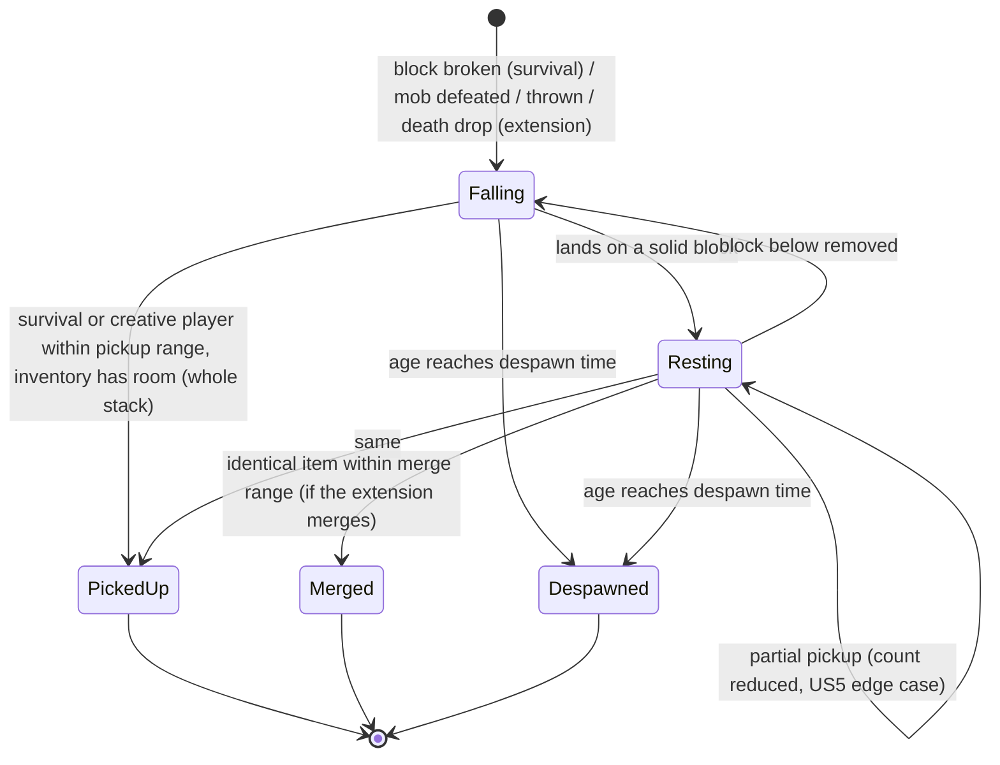
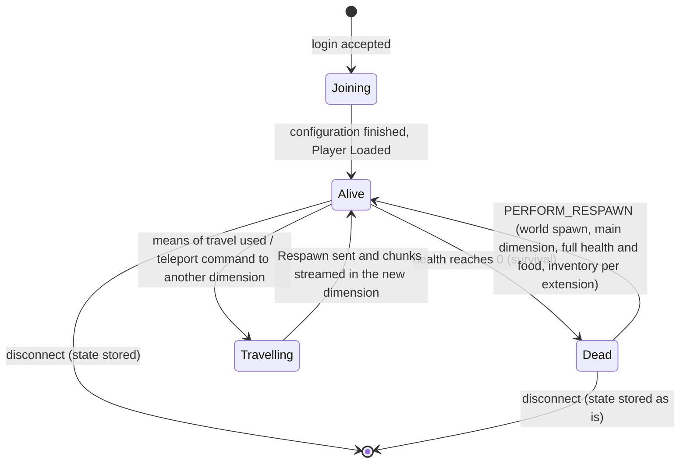
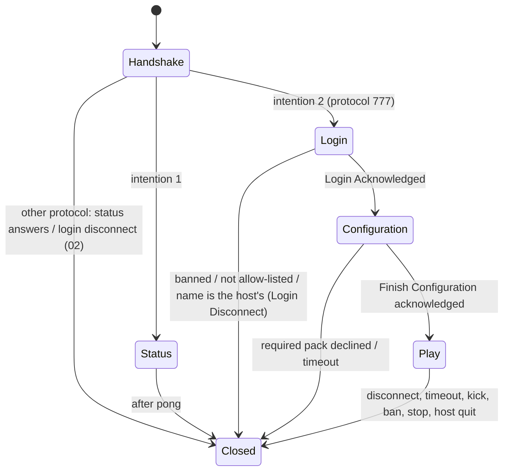

# Data Model: CobolCraft, complete

**Feature**: `001-cobolcraft-complete` | **Plan**: [plan.md](plan.md) | **Spec**: [spec.md](spec.md)

Entities from spec.md "Key Entities", with the fields, rules and state transitions the implementation keeps.
Content values (block, item, entity, recipe, weather, dimension and command definitions) live in
`docs/design/standin-content.md` as extended under FR-015; this document names the fields that hold them.
Persistent forms are in [contracts/world-folder.md](contracts/world-folder.md) and
[contracts/client-surface.md](contracts/client-surface.md). "Owner" is the package that holds the
authoritative copy.

## 1. World (owner: core)

| Field | Type | Rules |
|---|---|---|
| name | text ≤ 64 | Single-player list name (US16-1) |
| dimensions | list of Dimension | Every dimension of the extension, created with the world |
| time of day | ticks (Long) | Advances 1 per tick; full cycle = day length of standin-content §4.8 (US3-6); set by command |
| spawn point | dimension, x, y, z, yaw | New world: standin-content §5.2; set by command (FR-016) |
| players (stored) | map offline UUID → Player record | Every player who has been in the world (US13-4, US17-5) |
| operators, bans, allow-list | lists of offline identity | FR-016; console always has operator permission |
| settings | Server configuration | Not persisted in the world (US13 edge case: new settings apply to the old world) |

## 2. Dimension (owner: core)

| Field | Type | Rules |
|---|---|---|
| key | identifier | `cobolcraft:main` plus the extension's extra dimensions |
| dimension type | registry entry | Height range, light, sky, clock (extension) |
| generator | procedure id | Deterministic from position (FR-002) |
| chunks | map (cx, cz) → Chunk | Loaded on demand within any player's view distance |
| mobs, ground items | lists of Entity | Belong to this dimension only (US12 edge case) |
| weather | Weather | Absent for dimensions without weather (US11 edge case) |
| enabled | flag | Extra dimensions follow the `extra-dimensions` setting (US12-4) |

## 3. Chunk and Block (owner: core; replica: client)

- Chunk: 16 x height x 16 block states (state ids of standin-content §1.2 as extended), biomes per 4 x 4 x 4
  cell, sky and block light per standin-content §5.2, a changed flag (persist on save).
- Block state rules: placement only into `void` (§1.3); not into a position overlapping any player or mob;
  not outside the dimension's height range (US4 edge cases); baseplate unbreakable; cardstack axis from the
  clicked face; glowtube toggles `lit` on use without a held block; light recomputed for affected sections
  on place, break or toggle.
- Break timing (survival): `hand break time` of §1.1; one quarter with the matching tool (§2); the server
  times from Player Action 0 to 3 and refuses an early finish. Creative: instant.
- Concurrent changes: the server applies changes in arrival order; every player receives the final state
  (US4 edge case).

## 4. Item, Item stack and Inventory (owner: core; replica: client)

| Concept | Fields | Rules |
|---|---|---|
| Item | id, key, stack size, tool class, food value (food items), attack damage, icon | Registry of standin-content §2 as extended (food items, recipe results) |
| Item stack | item id, count | 1 ≤ count ≤ stack size; empty slot = no stack |
| Inventory | 36 slots: 0 to 8 hotbar, 9 to 35 main; held hotbar slot 0 to 8 | Survival starting items (§2) given once to a first-time survival player (US4-8) |

Transitions: add (fill matching stacks first, then empty slots in slot order; the part that does not fit is
not added: US5 edge cases), remove, move/swap between slots (US4-6), use-up one on survival place (US4 edge
case), craft (atomic: all ingredients removed and the result added, or nothing, US10-2 to 4).

## 5. Ground item (owner: core; replica: client)

| Field | Type | Rules |
|---|---|---|
| entity id | int | Per-run network id |
| stack | Item stack | |
| position, motion | doubles | Falls under the extension's gravity until resting on a solid block (US5-1) |
| age | ticks | Advances only while a player is within the extension's "near" distance (US5 edge case) |
| pickup delay | ticks | From the extension's throw rules (a thrown item is not picked up by the thrower at once) |

State machine:

Exactly-once pickup (SC-011, US5 edge case): pickups are resolved inside the single-threaded tick in player
order; the first player whose inventory accepts items takes them, and the entity's count is reduced before
the next player is checked.

## 6. Player (owner: core; the client holds the local player's predicted position)

| Field | Type | Rules |
|---|---|---|
| identity | name (1 to 16, `[A-Za-z0-9_]`), offline UUID | FR-010 |
| connection | connection id, phase | See §12 |
| dimension, position, yaw, pitch, on-ground | | Movement validated by the server against collision (US3-2) |
| game mode | survival / creative | FR-007; new players from settings / world / guest mode |
| flying | flag | Creative only (US3-3) |
| health | 0 to maximum (extension) | Survival only; creative takes no damage (US7-6) |
| food level | 0 to maximum (extension) | Survival only (US8-6) |
| exhaustion | accumulator | Raised by walking, running, jumping, attacking, breaking (US8-2, rates from extension) |
| eating | item, start tick | Completes after eating time unless released (US8 edge case) |
| inventory | Inventory | |
| operator status | flag | Granted/revoked by command (US14-5) |
| last fall start | y | For fall damage beyond the safe height (US7-2) |

Life state:

A player who disconnects while dead is stored with health 0 and is shown the death screen again on the next
join (the stored state is "as they left it", US13-4).

## 7. Mob (owner: core; replica: client)

| Field | Type | Rules |
|---|---|---|
| entity id, type | | Types from the extension (at least one passive, one hostile) |
| dimension, position, motion, yaw | | Movement per the extension; collides with blocks |
| health | | Damage from player attacks (held item's damage, US7-5) |
| target | player or none | Hostile only: nearest survival player within notice range; dropped when the target switches to creative, disconnects, dies or changes dimension (US9 edge case) |
| attack cooldown | ticks | Extension |

Spawning per dimension rules of the extension; hostile mobs neither spawn nor remain while `hostile-mobs` is
off (US9-6). Defeat: removed, yield spawned as ground items at its position (US9-4).

## 8. Recipe (owner: core content; replica: client)

Ingredients: list of (item, count); result: (item, count). Craftable for a player iff the inventory holds
every ingredient count and the result fits after the ingredients are removed (US10-1, US10-4). The display id
sent in Recipe Book Add is the recipe's index in the extension's recipe list.

## 9. Weather (owner: core per dimension; replica: client)

| Field | Rules |
|---|---|
| kind | One of the extension's kinds; each kind has a fixed (rain level, thunder level) pair on the wire (`wire-profile.md` §3.3) |
| remaining ticks | Counts down; at 0 the next kind and duration are chosen by the extension's frequency and duration rules, unless `weather-changes` is off (US11-4) |
| set by command | kind plus duration, or "until changed" (remaining = no countdown) |

Gameplay effects of a kind (extension) apply to players and mobs in biomes where the kind applies (US11-3).

## 10. Command (owner: core)

Name, argument syntax (tree nodes of the parsers in `wire-profile.md` §3.3), permission (everyone,
operator, console), executor. Permission check: console always permitted; chat permitted if everyone, or
operator status held (host in single-player/opened worlds; guests if allowed, FR-016). Errors produce the
extension's error text and change nothing (US14-3, US14-4, US15-3).

## 11. Server configuration (owner: server; passed to core as `CORE-SETTINGS`)

Fields, values and defaults: [contracts/operator-surface.md](contracts/operator-surface.md) §2.

## 12. Connection (owner: core server side, client client side)

## 13. Client-only models (owner: client)

| Model | Fields | Rules |
|---|---|---|
| Server list entry | name, address, pack policy | Persisted in `servers.dat`; status ping shows description, online count and protocol compatibility (US2-1, US2-2) |
| Single-player world entry | folder, `LevelName`, game mode | From `saves/`; create, open, delete-after-confirm (US16-1) |
| Resource pack | id, source (built-in, local zip, local folder, server), description, icon, compatibility (08 §2.3), enabled, position | Stack order: server packs (newest first) above enabled local packs (user order) above built-in (US18-2, 08 §9.6). Missing assets resolve to the missing-texture stripes (US18-5). |
| Server pack download | uuid, url, expected hash, state (queued, downloading, downloaded, failed, active) | Transitions and responses of 08 §9.1 and §9.2 |
| Screen model | current screen (title, server list, edit server, connecting, world, inventory, crafting, chat, pause, death, pack selection, pack confirm, world list, create world, confirm delete, open-to-others), its widgets and texts, HUD (hotbar, health, food, crosshair, chat lines, target highlight) | The UI layer writes it each frame; the renderer reads only it; tests assert on it |
| Render list | per frame: clear colour, matrices, ordered draws (slot, pipeline, texture) and the meshes uploaded since the last frame | Built by COBOL, submitted through `cc_vk_*`; tests assert on it |

Per-face brightness (research R13): top 1.0, north and south 0.8, east and west 0.6, bottom 0.5, multiplied by
`max(sky light × daylight factor, block light) / 15`, with a floor of 0.1.
