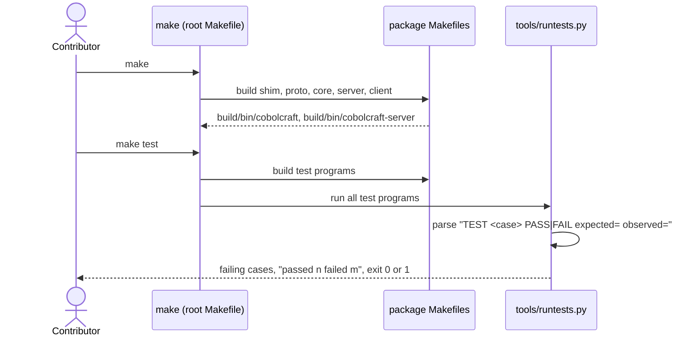
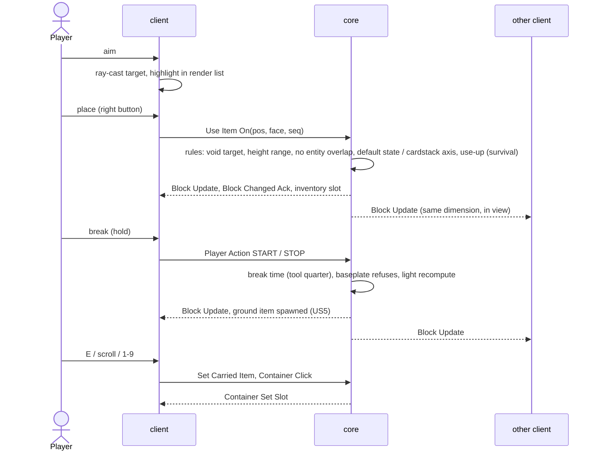
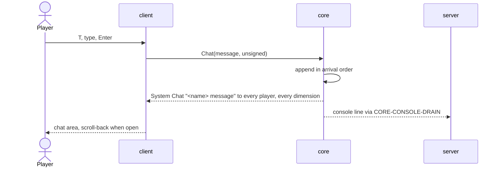
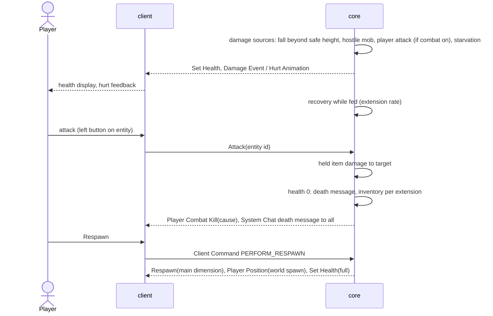
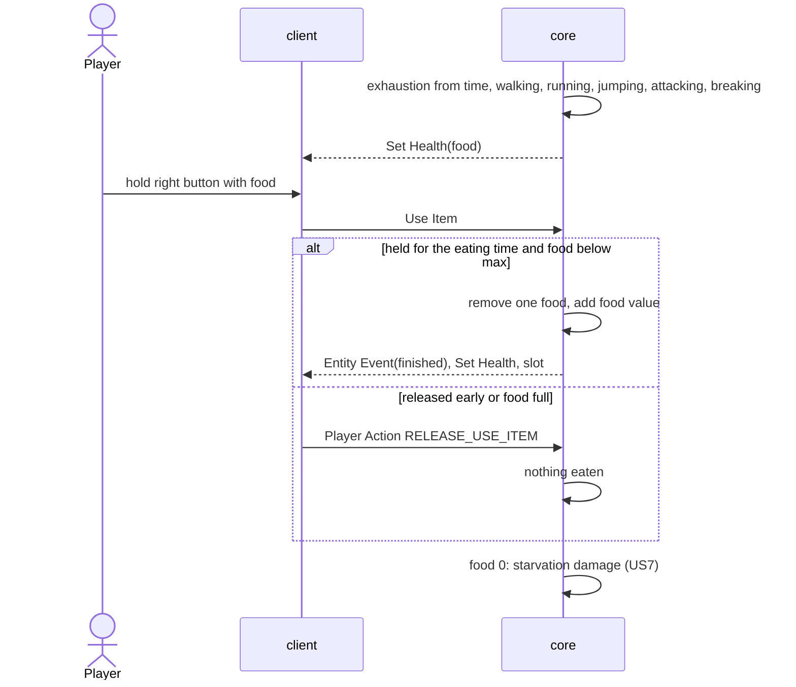
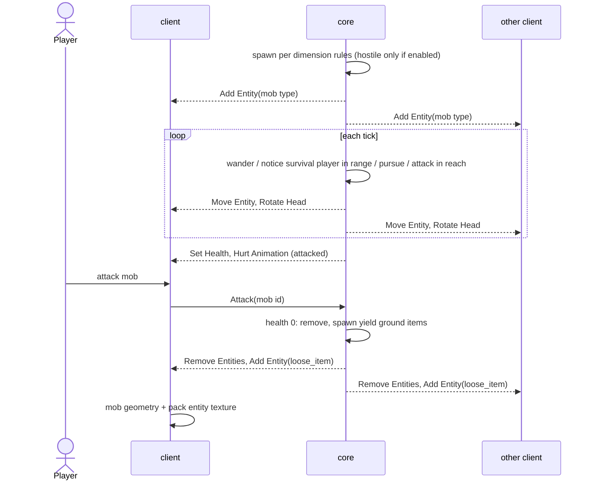
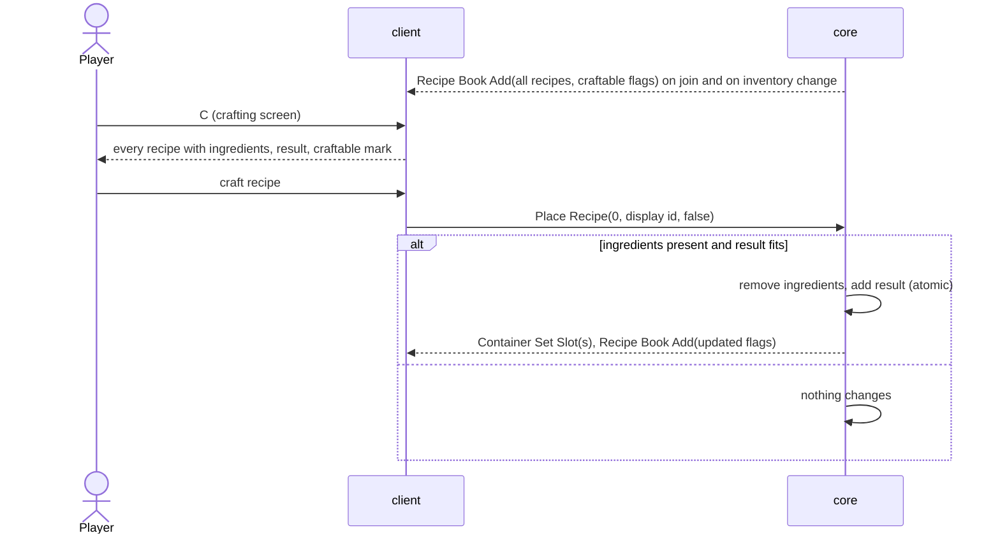
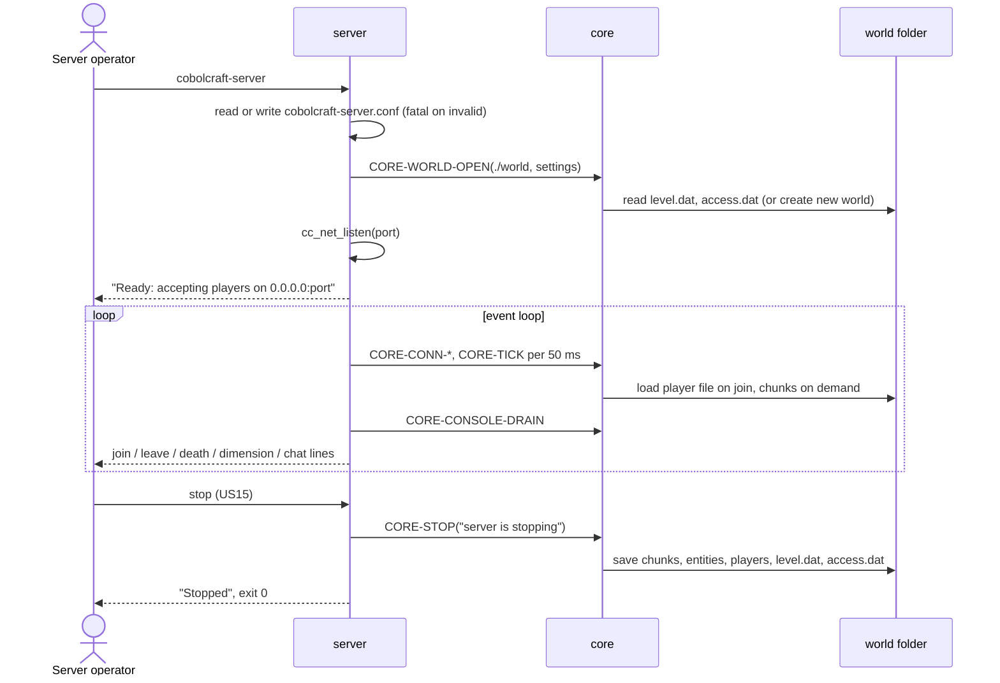
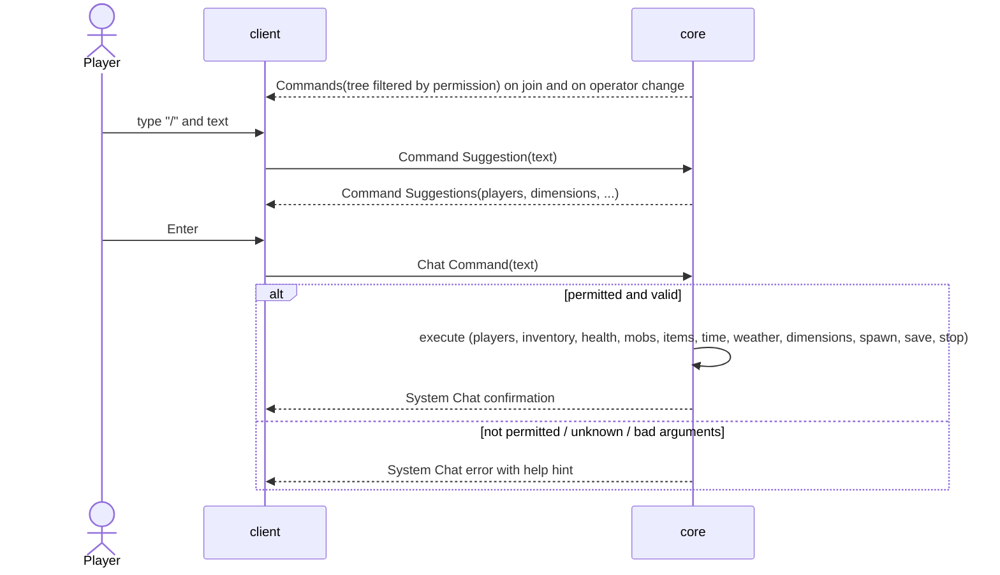
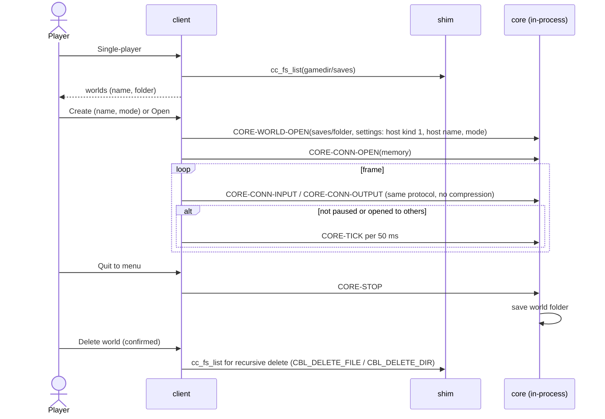

# Implementation Plan: CobolCraft, complete (game client and game server)

**Branch**: `001-cobolcraft-complete` | **Date**: 2026-11-05 | **Spec**: [spec.md](spec.md)

**Input**: Feature specification from `specs/001-cobolcraft-complete/spec.md`; constitution
`.specify/memory/constitution.md` (project v1.1.0 with SDD amendment v6.3.0); personas
`.specify/memory/personas.md`.

**Companion artifacts**: [research.md](research.md) (decisions R1 to R16, spike evidence, handoff
verification), [data-model.md](data-model.md), [contracts/](contracts/), [quickstart.md](quickstart.md),
[spikes/](spikes/).

## Open decisions for the operator

The tasks phase MUST NOT run while these markers remain (constitution 1.3). Each states the recommended
answer; the rest of this plan is written so that the recommended answer needs no further plan change.

1. **Q1 — Shim boundary for windowing, input, directory listing and console input.**
   `[NEEDS CLARIFICATION]` Constitution Principle I limits the C shim to "Vulkan, sockets, zlib, and
   cryptography". The spec needs four more capabilities that COBOL cannot reach without C (research R5):
   a window with its Vulkan surface and keyboard/mouse/text/scroll input (every on-screen story), directory
   enumeration (US16 world list, US18 packs folder; `C$LIST-DIRECTORY` is absent from GnuCOBOL 3.2, see
   `spikes/spike_fileio.out.txt`), non-blocking console line input (US15) and local network addresses
   (US17-1). Options:
   - **A (recommended)**: amend Principle I (PATCH or MINOR, by pull request per the constitution's
     Governance) to list "windowing and input (the window Vulkan presents into), directory enumeration and
     console input" as shim capabilities, reading local addresses as part of "sockets". Shim modules
     `cc_win`, `cc_fs`, `cc_con` of `contracts/shim-abi.md` then stand as designed.
   - **B**: no amendment; COBOL calls GLFW and libc directly with polling only. Consequences: no typed-text
     events (chat entry limited to a fixed US keyboard mapping), no scroll wheel for the hotbar, and
     platform-specific `struct dirent`/`ifaddrs` layouts in COBOL, which conflicts with FR-011's
     narrow-boundary rule.
   - **C**: the operator rules these are already within "Vulkan" and "sockets" as written (no amendment).
2. **Q2 — Workspace bootstrap command (constitution 5.2).** `[NEEDS CLARIFICATION]` This plan declares
   package-parallel mode, which requires the constitution to define the workspace bootstrap command; it does
   not. Recommended: amend the constitution's Development Workflow section to name `make bootstrap`
   (`contracts/test-harness.md` §1: checks the R1 prerequisites and compiles shaders; it starts no shared
   test infrastructure). Alternative: the operator directs standard mode instead (see "Execution mode").
3. **Q3 — Deferred-work tracking mechanism (constitution 1.4).** `[NEEDS CLARIFICATION]` The repository has
   no remote, no issue tracker and no debt log (research R15). No discovery needs deferral now, but an
   implement phase that meets one must halt without a mechanism. Recommended: a version-controlled log
   `docs/deferred-work.md` (one entry per item: date, discovering phase, description, why deferred under 1.4
   case (a) or (b), link to the spec/plan section), established by the operator; or a GitHub repository with
   Issues once a remote exists.

No external-dependency risk is open: every probe in research R1 to R11 succeeded.

## Summary

Build the CobolCraft game client and game server in GnuCOBOL 3.2 with a minimal C shim, playing the original
stand-in content over protocol 777, rendering only with Vulkan (MoltenVK on macOS arm64), with single-player,
open-to-others, health, hunger, ground items, mobs, crafting, weather, extra dimensions, a full command set,
persistence and resource packs.

Technical approach (research R2 to R13): five code packages plus test tooling. `shim` (C) is the only code
touching the operating system and third-party libraries. `proto` (COBOL) encodes and decodes the protocol's
data types, frames, NBT and chunks. `core` (COBOL) is the whole game: world, rules, persistence, commands and
the server side of the protocol, operating on byte streams. `server` (COBOL) is a thin program hosting `core`
on TCP with a configuration file and console. `client` (COBOL) is the game window: menus, input, the client
side of the protocol, resource packs, meshing and the render list, plus an in-process host that runs `core`
for single-player and opens it to others. Missing content and protocol facts are written into `docs/` first
(FR-005, FR-015). Everything is tested at the lowest layer that can express it, with 100 % line coverage of
COBOL and C measured by gcov.

## Technical Context

**Language/Version**: GnuCOBOL 3.2 (free format, `-std=default`, `-debug`) for all game logic; C11 (Apple
clang) for the shim; GLSL 450 compiled to SPIR-V at build time; Python 3 (stdlib only) for test and build
tooling.

**Primary Dependencies**: GLFW ≥ 3.4 (3.5.1 probed), Vulkan loader 1.4 + MoltenVK 1.4 (API 1.2 with
portability enumeration/subset), glslang 16, zlib (macOS SDK), OpenSSL 3 (`openssl@3`, pinned over
`openssl@4`). Research R1.

**Storage**: files only: world folders (NBT + Anvil region files, `contracts/world-folder.md`), the server
configuration file (`contracts/operator-surface.md`), the client's game directory
(`contracts/client-surface.md`), the pack download cache (08 §9.4).

**Testing**: COBOL and C test programs with a shared assertion library and output protocol, Python runner,
gcov line coverage for COBOL (`cobc --coverage`) and C (`clang --coverage`), lint with `cobc -Wall -Werror`,
`clang -Wall -Wextra -Werror`, `spirv-val`. Research R9, `contracts/test-harness.md`.

**Target Platform**: macOS on Apple silicon (arm64) only (FR-011); every platform call isolated in `shim`.

**Project Type**: two desktop programs (a GUI game client and a console game server) sharing libraries, in
one repository with independently buildable and testable packages.

**Performance Goals**: none (spec Assumptions; constitution 2.7). Game-content timings (tick rate 20 per
second, break times, day length, hunger rates, despawn times, weather durations) are content, not targets.

**Constraints**: COBOL for all game logic, shim minimal and logic-free (Principle I); implementation works
only from `docs/protocol/` and `docs/design/` (Principle II); offline identity only (FR-010); failures handled
only as FR-012 and research R14 state; single-threaded programs (research R6).

**Scale/Scope**: 18 user stories; 16 block states plus extension content; one world per process; view
distance up to 32 chunks.

## Constitution Check

*GATE: evaluated before Phase 0 and re-evaluated after Phase 1.*

| Principle | Status | Evidence |
|---|---|---|
| I. COBOL-first, minimal shim | **Pass, pending Q1** | All game logic in `proto`/`core`/`server`/`client` (COBOL). `shim` holds only the library and OS calls of `contracts/shim-abi.md`; Vulkan module submits COBOL-built geometry (R4). The four capabilities outside the listed shim set are raised as Q1, not assumed. |
| II. Spec is the source of truth | Pass | Every protocol, storage and content gap is written into `docs/` in the Foundational phase before code uses it (R8, R12, R13); contracts that touch the wire or disk are transcribed into `docs/protocol/` (07 §9, new 09). No implementer reads the jar. |
| 1.1 Artifact completeness | Pass | This plan and its companions carry every decision; nothing depends on session context. |
| 1.3 Clarification markers | **Open: Q1, Q2, Q3** | Tasks gate blocked until the operator decides. |
| 1.4 Deferred work | **Open: Q3** | Mechanism identified as absent (R15); no deferral made. |
| 2.5 Dependency-aware sequencing | Pass | Lane phases follow the spec's story order US1 → US18. |
| 2.6 Handoff consumed | Pass | All 16 handoff items recorded confirmed/refuted/superseded (research "Plan-Phase Handoff verification record"). |
| 3.1 External dependencies probed | Pass | GnuCOBOL, GLFW, Vulkan loader, MoltenVK, glslang, zlib, OpenSSL (hashes, TLS, trust override), BSD sockets: `spikes/`, research R1 to R11. |
| 3.2 Gap analysis | Pass | "Empirical gap analysis" below. |
| 3.3 Package boundaries and contracts | Pass | "Package boundary declaration" below; seven contracts in `contracts/`, materialized in Foundational before any consumer task. |
| 3.4 Test infrastructure | Pass (gap documented) | Nothing exists; setup tasks precede all feature tasks ("Infrastructure setup"). |
| 3.5 Sequence diagrams | Pass | One per story below. |
| 3.6 Execution mode | **Declared: package-parallel, pending Q2** | "Execution mode" below. |
| 3.8 Debt survey | Pass | "Technical debt survey" below. |
| 4.1 Test-first, ladder, BDD/CDD, doubles | Pass | "Test strategy" below. No test doubles: every external dependency is used for real in tests. |
| 4.2 Coverage | Pass | gcov 100 % for COBOL and C production sources (R9); exclusions only tests, tools, specs. |
| 4.3 E2E | Pass | Inventory empty, none proposed (R16). |
| 5.6 Error handling | Pass | Only defined outcomes are handled; everything else fatal or non-fatal per FR-012 and R14, with `-debug` loud failure. |

Post-design re-check (after Phase 1 artifacts): unchanged. The contracts introduced no new shim capability
beyond those already in Q1, and no behaviour without an acceptance criterion: the console line formats,
configuration keys, game directory layout and controls are the plan's realisation of FR-009, US13, US15,
US2-1, US16-1, US18-2 and the stories' controls.

## Project Structure

### Documentation (this feature)

```text
specs/001-cobolcraft-complete/
├── spec.md
├── plan.md                 # this file
├── research.md             # Phase 0
├── data-model.md           # Phase 1
├── quickstart.md           # Phase 1
├── contracts/              # Phase 1: shim-abi, proto-api, core-host-api, wire-profile, world-folder,
│                           #          operator-surface, client-surface, test-harness
├── spikes/                 # Phase 0 probes (spike_*), evidence (*.out.txt), spike_run.sh
├── checklists/requirements.md
└── tasks.md                # Phase 2 (/speckit-tasks), not created here
```

### Source code (repository root)

```text
Makefile                    # top-level commands of contracts/test-harness.md
README.md                   # Contributor documentation (US1): prerequisites, build, test, run
contract/                   # frozen shared contract surface (Foundational only; lanes read, never write)
├── include/ccshim.h
├── copy/CCSHIM.cpy  COREAPI.cpy  PROTO.cpy
└── fixtures/wire/*.hex
shim/                       # package: C platform shim → build/shim/libccshim.a
├── src/cc_log.c cc_net.c cc_con.c cc_zlib.c cc_crypto.c cc_tls.c cc_fs.c cc_win.c cc_vk.c
├── shaders/world.vert world.frag ui.vert ui.frag
└── tests/
proto/                      # package: COBOL protocol codec → build/proto/libproto.a
├── src/  (buffer, scalars, composites, nbt, frame, chunk)
└── tests/
core/                       # package: COBOL game core → build/core/libcore.a
├── copy/                   # content tables from docs/design/standin-content.md (as extended)
├── src/  (api, session, login, config-phase, registries, play, world, worldgen, light, chunks-stream,
│          players, inventory, blocks, ground-items, health, hunger, mobs, crafting, weather,
│          dimensions, commands, persistence)
└── tests/
server/                     # package: COBOL server program → build/bin/cobolcraft-server
├── src/  (main, config-file, console, tcp-host)
└── tests/
client/                     # package: COBOL client program → build/bin/cobolcraft
├── src/  (main, args, loop, input, screens/*, net-client, protocol-client, world-replica, physics,
│          packs/*, json, png, zip, http, atlas, models, mesher, entities-render, ui-render, render-list,
│          sp-host, game-dir)
└── tests/
tools/                      # test and build infrastructure (excluded from coverage)
├── runtests.py coverage.py lint.py bootstrap.sh
├── testlib/TESTLIB.cpy testassert.cob testlib.h
├── testsrv/                # loopback HTTP/HTTPS server + throwaway test CA
├── fixtures/textures/      # reference RGBA from an independent Python implementation of the recipes
└── tests/                  # acc_us1_* (build and test command behaviour)
tests/convergence/          # cross-package in-process acceptance tests (Convergence phase only)
docs/protocol/  docs/design/  # extended in Foundational (FR-005, FR-015)
```

**Structure decision**: packages `shim`, `proto`, `core`, `server`, `client`, `tools` are each built and tested
by their own `Makefile` (independently buildable/testable units, constitution 3.3). Dependencies:
`proto` → `shim`; `core` → `proto`, `shim`; `server` → `core`, `proto`, `shim`; `client` → `core`, `proto`,
`shim`. Packages link each other's library outputs and compile only against `contract/` for shared shapes.

## Package boundary declaration (constitution 3.3)

| Story | Packages touched | Kind |
|---|---|---|
| US1 Build and test | tools, shim, proto, core, server, client (per-package Makefile skeletons), root Makefile, README | multi (realised in Setup) |
| US2 Join | shim (log, net, zlib, md5, win, vk), proto, core, server, client | multi |
| US3 Move, stream | proto (movement/entity packets), core, client | multi |
| US4 Break/place | core, client | multi |
| US5 Ground items | core, client | multi |
| US6 Chat | core, client | multi |
| US7 Health | core, client | multi |
| US8 Hunger | core, client | multi |
| US9 Mobs | core, client | multi |
| US10 Crafting | proto (recipe display composites), core, client | multi |
| US11 Weather | core, client | multi |
| US12 Dimensions | core, client | multi |
| US13 Persistence, server lifecycle | core, server | multi |
| US14 Chat commands | proto (command tree nodes), core, client | multi |
| US15 Console commands | shim (con), core, server | multi |
| US16 Single-player | shim (fs), client | multi |
| US17 Open to others | shim (local addresses), core, client | multi |
| US18 Resource packs | shim (tls, sha1, fs), core (pack offer), server (pack config keys), client | multi |

**Contracts** (all in [contracts/](contracts/); fixed before any task that consumes them):

| Contract | Seam (provider → consumers) | Materialized as |
|---|---|---|
| `shim-abi.md` | shim → proto, core, server, client | `contract/include/ccshim.h`, `contract/copy/CCSHIM.cpy` |
| `proto-api.md` | proto → core, client | `contract/copy/PROTO.cpy`, `contract/fixtures/wire/frame-*.hex` |
| `core-host-api.md` | core → server, client | `contract/copy/COREAPI.cpy` |
| `wire-profile.md` | core (server side) ↔ client (client side) | `docs/protocol/09-cobolcraft-profile.md`, `contract/fixtures/wire/*.hex` |
| `world-folder.md` | core (writer/reader) ↔ Server operator / Player (copying folders) | `docs/protocol/07-nbt-and-anvil.md` §9 |
| `operator-surface.md` | server ↔ Server operator | `server` implementation only (no shared artifact) |
| `client-surface.md` | client ↔ Player, Pack creator | `client` implementation only |
| `test-harness.md` | tools ↔ every package, Contributor | root and per-package `Makefile`s (Setup) |

## Execution mode (constitution 3.6)

**Declared: package-parallel** (pending Q2). Justification: all 17 feature stories after US1 cross package
boundaries, and the per-package work is large and disjoint (core and client each carry every gameplay story;
shim, proto and server carry several), so concurrent lanes repay their overhead; the frozen contracts above
license the split. Fast pass is excluded (contracts, far more than three files); standard would serialize
hundreds of disjoint package tasks.

Shape for the tasks phase (constitution 5.2):

| Phase | Content | Gate command |
|---|---|---|
| Setup | US1: `tools/` (runner, coverage, lint, testlib, bootstrap), root `Makefile`, every package's `Makefile` skeleton, `README.md`, `acc_us1_*` tests | `make gate-tools` |
| Foundational | (1) docs-first: FR-015 extension of `docs/design/standin-content.md` (sections listed in research R13, including the bitmap font), 08 additions, 07 §9, new 09; (2) contract materialization: `contract/include/ccshim.h`, `contract/copy/*.cpy`, every wire fixture; (3) shared test infrastructure: `tools/testsrv/`, `tools/fixtures/textures/` generator. Documents are verified by review tasks (constitution 4.1). | `make gate-contract` (compiles every copybook and header in a probe program, checks every fixture parses as hex; lint) |
| PARALLEL GROUP | Lanes `shim`, `proto`, `core`, `server`, `client`; each lane runs its stories' slices in spec order; story tags `US<n>-<pkg>` | `make gate-<pkg>` per lane phase |
| Convergence | `tests/convergence/acc_us<n>_*.cob`: each story's acceptance scenarios that need more than one package, run in-process through the client's single-player host (client + core over a memory connection) and, for network-only behaviour, the core TCP host on loopback; no E2E (empty inventory) | `make gate` |
| Polish | README completion, quickstart walk-through review, final debt check of touched files | `make gate` |

Lane notes: the `shim` lane's US2 slice delivers every module except `cc_con` (US15), `cc_fs` (US16/US18),
local addresses (US17) and `cc_tls`/`cc_sha1` (US18). The `server` lane has slices for US2, US13, US15, US18.
The `proto` lane has slices for US2, US3, US10, US14.

## Infrastructure setup (constitution 3.4)

Detected (research R16): no build system, no test framework, no coverage or lint tooling, no CI, no
remote. Critical infrastructure is missing, so these setup tasks precede every feature task (Setup and
Foundational phases above): the runner and output protocol, the COBOL and C assertion libraries, coverage and
lint drivers, `make bootstrap`, per-package Makefiles, the loopback HTTP/HTTPS test server with a test CA
(used through the standard `SSL_CERT_FILE`, no shipped test hook), the texture reference fixtures. CI is not
set up: the spec's verification surface is the Contributor's local terminal (US1, SC-001), and no remote
exists. Contract-test conventions: `contract_<seam>_<side>` files in each package's `tests/`, verified
in-process against `contract/` artifacts by every lane gate.

## Test strategy (constitution 4.1, 4.2, 4.3)

- **Test-first**: every implementation task is preceded by the test task that defines it; the tasks phase
  orders test before implementation within each lane phase.
- **Acceptance tests** (`acc_` prefix, case names with "acceptance" and Given/When/Then, research R9): one or
  more cases per acceptance scenario of spec.md. Placement rule:
  - Outcome observable from one package's surface → that package's lane (for example US13-2 configuration
    file in `server`; US2-1 server list persistence in `client`; US4-3 break timing and ground-item creation
    in `core`, driven through `CORE-*` entry points with fixture packets).
  - Outcome that needs client and core together (for example US4-7 "the other Player sees the same change",
    US16-2, US17-2) → `tests/convergence/` in the Convergence phase, two in-process clients against one core.
  - US1 → `tools/tests/acc_us1_*.py` (they run the real `make` targets in a scratch copy of the repository).
  - Client outcomes are asserted on the screen model and render list (data-model §13); texture outcomes on
    atlas bytes against `tools/fixtures/textures/`; GPU submission is covered by shim tests against the real
    GPU.
- **Contract tests**: both sides of every contract in the table above (`contract_*` files named in each
  contract document), lane-resident.
- **Implementation tests** (`test_` prefix): everything acceptance tests leave uncovered, to 100 % line
  coverage of `shim/src`, `proto/src`, `core/src`, `core/copy`, `server/src`, `client/src`.
- **Test doubles**: none. Real MoltenVK, real hidden GLFW windows, real loopback sockets, real zlib and
  OpenSSL, real local HTTP/HTTPS server. No operator decision needed.
- **E2E**: existing inventory empty; no journey proposed (research R16). Convergence and terminal gates run
  no E2E environment.
- **Document deliverables** (docs extensions, README): verified by review tasks, not tests.

## Empirical gap analysis (constitution 3.2)

**Package pass** (each declared package read as it exists on 2026-11-05):

| # | Package | Finding | Impact | Evidence weight |
|---|---|---|---|---|
| P1 | shim, proto, core, server, client, tools | Package does not exist; everything is new work. | HIGH | Confirmed by reading: repository tree is `.claude/`, `.specify/`, `docs/`, `specs/` only (`ls -a` at root). |
| P2 | shim | GLFW cannot find Homebrew's Vulkan loader without `glfwInitVulkanLoader`. | HIGH | Confirmed by reading `spikes/spike_vulkan_glfw.out.txt` ("without handoff": `vulkanSupported=0`, surface `-3`). Resolved: shim-abi §8. |
| P3 | shim | `pkg-config openssl` picks OpenSSL 4 when both are installed. | MEDIUM | Confirmed by reading the spike build warning (`openssl@4/4.1.0/include`, R1). Resolved: pin. |
| P4 | shim/client | Framebuffer size differs from window size on Retina. | MEDIUM | Confirmed by `spike_vulkan_glfw.out.txt` (`extent=640x480` for a 320 x 240 window). Resolved: `cc_win_size`. |
| P5 | core/client (COBOL) | No directory listing in GnuCOBOL 3.2. | HIGH | Confirmed by `spikes/spike_fileio.out.txt` (`C$LIST-DIRECTORY NOT AVAILABLE`). Routed to Q1. |
| P6 | core/client (COBOL) | Fixed-format column-72 limit breaks long statements. | LOW | Confirmed by the `spike_fileio.cob` compile error (R2). Resolved: free format. |
| P7 | docs (consumed by core, client) | standin-content lacks every FR-015 section; §1.3 and §3 conflict with FR-002's ground-item rule. | CRITICAL | Confirmed by reading `docs/design/standin-content.md` §1.3 ("No drops in the stand-in"), §3 (`loose_item` "Optional"), headings §0 to §8. Resolved: Foundational docs tasks (R13). |
| P8 | docs | 08 marks fonts "later" and has no entity, weather or font assets; Open questions 4 and 6 unresolved. | HIGH | Confirmed by reading 08 §8 table and "Open questions". Resolved: R13. |
| P9 | docs | 07 defines no `level.dat`, player, access or entity NBT, nor per-dimension folders. | HIGH | Confirmed by reading 07 §6 to §8 headings and §8 text. Resolved: R8, `world-folder.md`. |
| P10 | docs | No document states CobolCraft's protocol choices (compression threshold, which packets carry weather, crafting, etc.). | HIGH | Confirmed by reading `docs/protocol/README.md` index (00 to 08 only). Resolved: `wire-profile.md` → 09. |

**Seam pass** (one check per declared contract):

| Contract | Producer behaviour vs consumer assumption | Finding |
|---|---|---|
| shim-abi | Consumers assume non-blocking sockets, `EAGAIN` as "nothing now", 0-byte recv as closed, poll readiness. | Matches: `spike_libs.out.txt` (`nb-connect ... in progress`, `recv-empty ... Resource temporarily unavailable`, `recv-after-peer-close=0`). |
| shim-abi (vk) | Client assumes a textured, depth-tested, blended triangle-list pipeline with a mat4 push constant. | Matches: `spike_pipeline.out.txt`. |
| proto-api | core/client assume zlib-wrapped compression for frames and gzip for files. | Matches: `spike_libs.out.txt` (`header=789c`, `magic=1f8b`). |
| core-host-api | Hosts assume the core runs single-threaded on bytes; R7 assumes memory connections skip compression. | Matches 02 Offline mode text. |
| wire-profile | Client assumes unsigned chat accepted; crafting and weather fit existing packets. | Matches 05c "Signed chat", 05c 0x27, 05b 0x4B, 05a 0x27 tables (research R12). |
| world-folder | Server and single-player assume one shared format. | By construction (one core). |
| operator-surface, client-surface, test-harness | Single-sided contracts (person ↔ package). | No producer/consumer mismatch possible beyond the package's own tests. |

**Rollup**: P1 (HIGH, structural: all new), P7 (CRITICAL, resolved by Foundational docs), P2/P3/P4/P6
(resolved in contracts/research), P5 (routed to Q1), P8/P9/P10 (resolved by Foundational docs). No suspected
finding remains unconfirmed.

**Coverage critic**: every declared package (shim, proto, core, server, client, tools) has at least one
package-pass row (P1 covers all); every contract has a seam-pass row.

**Routing**: P5 → Q1 (operator); all others fixed in this plan.

## Technical debt survey (constitution 3.8)

The repository holds no code, so tiers 1 and 3 have nothing to find in code. Admitted files are the documents
the feature touches:

| Tier | File | Finding | Planned removal |
|---|---|---|---|
| 1 | — | No suppression directives exist (no code). | — |
| 2 | `docs/design/standin-content.md` §1.3, §3 | Stale "first milestone" wording ("No drops in the stand-in", `loose_item` "Optional. Not needed for the first milestone") contradicting FR-002. | Rewritten by the Foundational FR-015 tasks. |
| 2 | `docs/protocol/08-resource-packs.md` §8 | "Minimal"/"later" column describes a superseded milestone (font now required). | Updated in Foundational (R13). |
| 2 | `docs/protocol/08-resource-packs.md` Open questions 4, 6 | Open questions the renderer depends on. | Answered in Foundational (R13). |
| 2 | `docs/design/standin-content.md` §8 "Open questions" | Entries touched by the extension (for example `world_clock`) must be closed or restated when the extension edits those sections. | Same Foundational tasks. |
| 3 | — | No existing architecture to reuse; the plan's structural choice (one core used by both hosts, one protocol path for single-player and network) removes a second game implementation and a second client protocol path entirely. | Built in from the start. |

Spikes are throwaway and excluded from build, lint and coverage.

## Sequence diagrams (constitution 3.5)

Participants: `P` Player / `O` Server operator / `C` Contributor; `CL` client; `SH` shim; `PR` proto;
`CO` core; `SV` server program.

### US1 — Build and test



### US2 — Start, connect, enter the world

```mermaid
sequenceDiagram
    actor P as Player
    participant CL as client
    participant SH as shim
    participant SV as server
    participant CO as core
    P->>CL: cobolcraft --name P
    CL->>SH: cc_win_open, cc_vk_init
    CL->>CL: load built-in + enabled packs, stitch atlas, bake models
    CL->>SH: cc_vk_texture(atlas)
    P->>CL: server list: add entry (saved to servers.dat)
    CL->>SH: cc_net_connect; send Intention(status), Status Request
    SH->>SV: bytes
    SV->>CO: CORE-CONN-INPUT
    CO-->>SV: Status Response (description, online)
    SV-->>CL: bytes
    CL-->>P: entry shows description and players online
    P->>CL: Join
    CL->>SV: Intention(login), Hello(name)
    SV->>CO: CORE-CONN-INPUT
    CO-->>CL: Set Compression, Login Finished (offline UUID)
    CL->>CO: Login Acknowledged, brand, Client Information
    CO-->>CL: brand, features, Select Known Packs, Registry Data..., Update Tags, Finish Configuration
    CL->>CO: Select Known Packs, Finish Configuration
    CO-->>CL: Login(play), Player Position, chunks (batch), Set Time, inventory
    CL->>CO: Accept Teleportation, Chunk Batch Received, Player Loaded
    CL->>CL: decode chunks, mesh sections (culling, shading, light)
    CL->>SH: cc_vk_mesh, frame_begin, draw, frame_end
    CL-->>P: world at spawn, facing east, pillar ahead
    P->>CL: disconnect control
    CL-->>P: server list
```

### US3 — Move, look, stream terrain, see others, day and night

```mermaid
sequenceDiagram
    actor P as Player
    participant CL as client
    participant CO as core
    P->>CL: keys and mouse (cc_win_poll events)
    CL->>CL: physics: walk, jump, collide, fall, fly (creative)
    CL->>CO: Move Player Pos/Rot, Player Abilities (flying)
    CO->>CO: validate against collision; update chunk centre
    CO-->>CL: Set Chunk Cache Center, new chunks, Forget Level Chunk
    CO-->>CL: other players: Add Entity, Move Entity, Rotate Head, Remove Entities
    CO-->>CL: Set Time each second
    CL->>CL: re-mesh loaded sections, drop forgotten ones, sky colour from time
    CL-->>P: terrain to view distance, other players as operator figures, day/night sky
```

### US4 — Break, place, toggle, inventory



### US5 — Ground items

```mermaid
sequenceDiagram
    actor P as Player
    participant CL as client
    participant CO as core
    CO->>CO: yield / throw creates loose_item (motion, age, pickup delay)
    CO-->>CL: Add Entity(loose_item), Set Entity Data(item stack)
    loop each tick
        CO->>CO: gravity, rest on block; age only near players; despawn at limit
        CO-->>CL: Teleport/Move Entity or Remove Entities (despawn)
    end
    P->>CL: walk near item
    CO->>CO: pickup in player order, partial if inventory nearly full
    CO-->>CL: Take Item Entity, Remove Entities (or Set Entity Data with reduced count), inventory slots
    P->>CL: Q / Ctrl+Q
    CL->>CO: Player Action DROP_ITEM / DROP_ALL_ITEMS
    CO-->>CL: inventory slot, Add Entity(thrown item)
```

### US6 — Chat



### US7 — Health, damage, death, respawn



### US8 — Hunger and eating



### US9 — Mobs



### US10 — Crafting



### US11 — Weather

```mermaid
sequenceDiagram
    actor P as Player
    participant CL as client
    participant CO as core
    participant CL2 as other client (same dimension)
    loop each tick per dimension with weather
        CO->>CO: remaining--; at 0 choose next kind and duration (if weather changes on)
    end
    CO-->>CL: Game Event START/STOP_RAINING, RAIN_LEVEL, THUNDER_LEVEL (kind pair)
    CO-->>CL2: same
    CO->>CO: apply kind's gameplay effect to players and mobs in applicable biomes
    CL->>CL: kind from pair; sky tint and weather geometry where biome allows
    CL-->>P: weather shown
```

### US12 — Dimensions

```mermaid
sequenceDiagram
    actor P as Player
    participant CL as client
    participant CO as core
    P->>CL: use the means of travel
    CL->>CO: (interaction packet the extension defines)
    alt extra dimensions enabled
        CO->>CO: move player to target dimension arrival point; mobs and items stay
        CO-->>CL: Respawn(target spawn info), Player Position, chunks, weather pair, Set Health, inventory
        CL->>CL: drop old dimension replica, new sky/light/weather
    else disabled
        CO->>CO: player stays
    end
```

### US13 — Server lifecycle and persistence



### US14 — Chat commands



### US15 — Console commands

```mermaid
sequenceDiagram
    actor O as Server operator
    participant SH as shim
    participant SV as server
    participant CO as core
    SV->>SH: cc_net_poll(include console)
    SH-->>SV: console ready
    SV->>SH: cc_con_readline
    SV->>CO: CORE-CONSOLE(line) with operator permission
    SV->>CO: CORE-CONSOLE-DRAIN
    SV-->>O: result or error text
    opt stop command
        CO-->>SV: run state 1
        SV->>CO: CORE-STOP
        CO-->>SV: run state 2, disconnect bytes queued
        SV-->>O: Stopped; exit
    end
```

### US16 — Single-player



### US17 — Open to others

```mermaid
sequenceDiagram
    actor P as Host Player
    participant CL as host client
    participant SH as shim
    participant CO as core (in-process)
    participant G as guest client
    P->>CL: Pause → Open to others (guest mode, guest operator)
    CL->>CO: CORE-OPEN-TO-OTHERS
    CL->>SH: cc_net_listen(0), cc_net_local_addresses
    CL-->>P: "address:port" shown; pause no longer pauses
    G->>CL: TCP connect (as to a server)
    CL->>CO: CORE-CONN-OPEN(network), bytes both ways
    CO->>CO: refuse name equal to host; stored guest state restored
    P->>CL: Quit world
    CL->>CO: CORE-STOP("host closed the world")
    CO-->>G: Disconnect; world saved
```

### US18 — Resource packs

```mermaid
sequenceDiagram
    actor P as Pack creator / Player
    participant CL as client
    participant SH as shim
    participant CO as core
    P->>CL: Pack selection screen
    CL->>SH: cc_fs_list(resourcepacks)
    CL->>CL: read pack.mcmeta (zip via cc_inflate raw / folder), compatibility, icon
    P->>CL: enable, order (confirm if incompatible)
    CL->>CL: save options.dat; reload: stack, resolve files, errors named, stripes for unresolved
    CO-->>CL: Resource Pack Push (configuration, when offered)
    CL->>CL: policy prompt / always / never (servers.dat)
    CL->>CO: Resource Pack Response 3 accepted
    alt cached under downloads/uuid/sha1
        CL->>CL: cache hit
    else
        CL->>SH: cc_net_connect / cc_tls_connect, HTTP GET, cc_sha1
    end
    CL->>CO: 4 downloaded, then 0 successfully loaded (or 2 / 6 / 7)
    alt required and declined
        CL->>CL: disconnect with required-pack message
    end
```

## Risks

| Risk | Impact | Mitigation |
|---|---|---|
| Content authoring volume in Foundational (mobs, recipes, weather, dimensions, commands, font) is large and blocks every lane. | Schedule | Each FR-015 section is its own document task with its own review; lanes start only after all are reviewed (constitution 5.2 narrow Foundational). |
| GPU tests need a logged-in macOS session; no CI. | Verification only runs locally | Matches the spec's verification surface (US1, SC-001); recorded in R16. |
| COBOL code size for JSON, PNG, zip, HTTP and meshing in the client. | Effort | Each is a separate client module with its own implementation tests; no performance target. |
| Q1 answered B. | Shim modules `cc_win`, `cc_fs`, `cc_con` replaced by COBOL calls to GLFW/libc; text input and scroll lost. | Plan return required; isolated by module so only those modules and their consumers change. |

## Deferred work

None. Every discovery of this phase is incorporated (gap analysis routing). Mechanism: Q3.

## Complexity Tracking

No constitution violation is planned. Q1 is an open question about Principle I's scope, not a deviation:
no `cc_win`, `cc_fs` or `cc_con` code is written until the operator decides.
