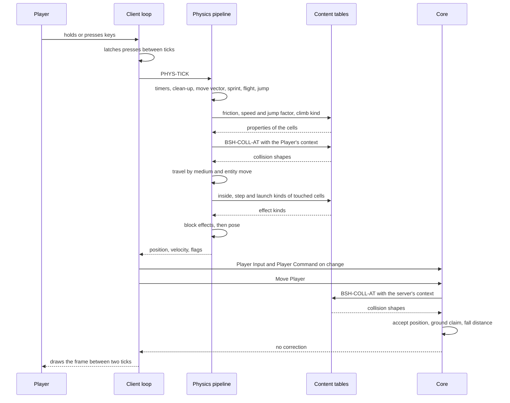
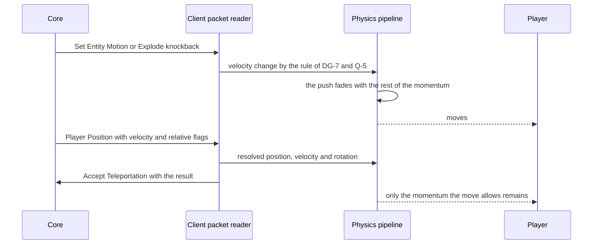

# Implementation Plan: Movement That Matches Minecraft

**Branch**: `003-vanilla-movement` | **Date**: 2026-11-26 | **Spec**: [spec.md](spec.md)

**Input**: `specs/003-vanilla-movement/spec.md`; constitution `.specify/memory/constitution.md` (project Principles I
and II with SDD amendment v6.3.0); personas `.specify/memory/personas.md`. Behaviour values come from
`docs/protocol/` and `docs/design/` only (Principle II); this plan decides packages, modules, data flow, tests and
gates, not game values.

**Companion artifacts**: [research.md](research.md) (probes, handoff verification, documentation gaps, decisions R1
to R14), [data-model.md](data-model.md), [contracts/](contracts/), [quickstart.md](quickstart.md),
[spikes/](spikes/).

## Open questions for the operator (constitution 1.3)

The tasks phase must not start while any of these is open.

### Q-1 Authorise the clean-room round

[NEEDS CLARIFICATION: Q-1. FR-002 requires a clean-room round for the gaps DG-1 to DG-9 of research.md section 3
(DG-10 too if Q-3 is B), and the round needs the client jar supplied by the operator. Options: A, authorise one round
now, before the tasks phase, and give the jar's path (recommended: decision R14); B, authorise it as the first
Foundational work of implementation, accepting that tasks are written against unconfirmed contracts; C, do not
authorise it, in which case the blocked slices of research.md section 3 cannot be built and the spec must be
narrowed.]

### Q-2 The first moment on ice

[NEEDS CLARIFICATION: Q-2. US1 acceptance scenario 3 says a Player walking from ordinary ground onto ice keeps
holding forward and carries their speed onto the ice "with no sudden slowdown". The movement rules (13 section 1.3,
18 section 3.2) give a dip: 0.216 blocks a tick on ground, 0.140 on the first ice tick, back to about 0.207 within
two seconds (spikes/spike_move_current.out.txt). Today's client falls to 0.021. Options: A, follow the movement
rules and Minecraft, and reword scenario 3 to what they give (recommended: FR-001 and SC-003 ask for Minecraft's
movement); B, remove the dip, which departs from the documents and from Minecraft.]

### Q-3 Effects and enchantments that change movement

[NEEDS CLARIFICATION: Q-3. 13 section 1 names Jump Boost, Slow Falling, Dolphin's Grace and Blindness, which this
plan includes because the client already knows its effects. Speed, Slowness, Levitation, and the enchantments Soul
Speed, Depth Strider and Swift Sneak act through attributes or are not named there; the server sends a Player no
attribute values today and the client applies none. Are they part of this feature? Options: A, no: movement uses the
default attribute values, and the rest is recorded as a deferred ticket (recommended: the spec names no effect or
enchantment, and B adds a server subsystem); B, yes: the core computes and sends the movement attributes, the client
reads them, Levitation joins the client's effects, and the round also covers DG-10. Powder snow's freezing slow-down
stays out under either answer ("freezing" is unchanged by the spec's Assumptions).]

### Q-4 Fall distance in blocks that break a fall

[NEEDS CLARIFICATION: Q-4. The documents reset a Player's fall distance in cobwebs, berry bushes, powder snow, bubble
columns and while sliding down honey, and a powder snow landing deals no fall damage. The server resets it only in
water and on climbables (core/src/movement.cob lines 302 to 312), so a Player slowed by these blocks would still take
damage for the whole height. The spec says a block's "other effects, such as damage or freezing, are unchanged".
Options: A, treat the reset as part of the block's movement effect and build it in the server (recommended: without it
a slow fall through a cobweb hurts, which Minecraft does not do); B, leave fall damage as it is and record a deferred
ticket.]

### Q-5 What a hit does to the Player's momentum

[NEEDS CLARIFICATION: Q-5. The spec's edge case says a push from a hit or an explosion "adds to the Player's
momentum". No document says what the client does with Set Entity Motion or the Explode knockback (DG-7), and the
server builds a hit's velocity as if the Player stood still (core/src/combat.cob). If the round finds that Minecraft
replaces the momentum rather than adding to it, which holds? Options: A, the documented Minecraft behaviour, and the
edge case is reworded to match (recommended: FR-001, SC-003); B, the edge case as written: the push is added.]

## Summary

A Player's movement in the CobolCraft window follows the documented Minecraft rules in every medium and against every
block that changes movement (US1, the only story). Today the walking speed is applied at full strength in one tick,
momentum exists only as special cases for ice and knockback, and most block effects are missing (probe and code
reading).

Technical approach: replace the movement step of the client with one velocity and the documented tick pipeline
(input, jump, travel by medium, entity move, block effects, pose) (R3); put every block's movement properties and the
shapes that depend on the Player into `content`, shared by client and server (R4, R5, R6); align the server's
movement check with it so nothing is pulled back (R8); close the documentation gaps through one clean-room round
before tasks (R14).

## Technical Context

**Language/Version**: GnuCOBOL 3.2.0, free format, `-std=default`, `-debug` (release `-O2`), with the `FPFAST`
arithmetic overlay of `tools/package.mk`. No C change planned (Principle I).

**Primary Dependencies**: none new.

**Storage**: none new. No saved world or player field changes.

**Testing**: `acc_`, `contract_`, `test_` programs, `tools/runtests.py`, gcov to 100 %, `tools/lint.py`;
cross-package tests in `tests/convergence/`.

**Target Platform**: macOS on Apple silicon.

**Project Type**: desktop game client and server in one repository of packages.

**Performance Goals**: none requested by the spec (Principle 2.7). Measured: one tick of two-axis arithmetic costs
1.25 us (research section 1).

**Constraints**: SC-001 (0.001 blocks against every worked example); no pull-back or disconnect (US1-13, SC-004).

**Scale/Scope**: three packages and the convergence tests; `client/src/physics.cob` (1131 lines) restructured; 48
client test programs step the changed client tick.

## Constitution Check

*Evaluated before Phase 0 and again after Phase 1. No violation needs a Complexity Tracking entry.*

| Principle | Status | Evidence |
|---|---|---|
| I. COBOL-first | Pass | All logic is COBOL; no new glue |
| II. Spec is the source of truth | Pass, with a prerequisite | Gaps are listed with document and section (research section 3); no value is filled from recall; the jar was not read. The round is open question Q-1 |
| 1.1, 1.2 Artifacts and sessions | Pass | This plan and its companions carry the decisions; the phase worked from spec.md and the repository |
| 1.3 Markers and tasks gate | Open | Five open questions (Q-1 to Q-5) halt the tasks phase |
| 1.4 Deferred work | Pass | Tracker: Spile tickets in `tickets/` (prefix `CC`). CC-0054, CC-0055, CC-0056 recorded; further tickets follow from answers A of Q-3 and B of Q-4 |
| 2.5 Sequencing | Pass | One story; slice order below |
| 2.6 Handoff consumed | Pass | research section 2, H1 to H10 |
| 3.1 External dependencies probed | Pass with one risk | GnuCOBOL arithmetic and comparisons probed; the real client cannot be probed here (SC-003 is a manual check) |
| 3.2 Gap analysis | Pass | below |
| 3.3 Boundaries and contracts | Pass | two contracts in `contracts/`; both can change with DG answers, which returns to this plan |
| 3.4 Test infrastructure | Pass | below |
| 3.5 Sequence diagrams | Pass | US1, below |
| 3.6 Execution mode | Pass | standard |
| 3.7 Summary | Done at the end of the phase | not written into this file |
| 3.8 Debt survey | Pass | below |
| 4.1, 4.3 Tests and E2E | Pass | test strategy; E2E inventory empty; no test double |
| 5.6 Error handling | Pass | none added; the spec asks for none |

## Prerequisite: clean-room round

Nine gaps (DG-1 to DG-9, plus DG-10 under Q-3 B) are listed with document, section and missing rule in
[research.md](research.md) section 3. The round follows `.claude/skills/clean-room/SKILL.md` (reader, reviewer,
commit `docs(protocol): ...`), runs when Q-1 authorises it, and is followed by a check of
[data-model.md](data-model.md) and [contracts/](contracts/) against its text before tasks are generated (R14). A
behaviour found missing from the contracts changes the contract here, not in a task.

## Project Structure

### Documentation (this feature)

```text
specs/003-vanilla-movement/
├── spec.md
├── plan.md
├── research.md
├── data-model.md
├── contracts/
│   ├── block-movement.md        content -> client, core
│   └── player-motion-wire.md    core <-> client
├── quickstart.md
├── spikes/                      spike_move_arith.cob, spike_move_reference.py, spike_move_current.cob, outputs
└── checklists/requirements.md
```

### Source code (touched)

```text
contract/copy/CTBSHAPE.cpy       extended movement tables
contract/copy/CTBSCTX.cpy        new: collision context
contract/cases/, contract/fixtures/wire/   cases and fixtures of the two contracts
content/src/block-movement.cob   new: the movement table, BSH-COLL-AT, PLAYER-POSE-BOX
content/src/block-shapes.cob     friction and climbable lists move out
client/src/physics.cob           PHYS-TICK (pipeline order) and PHYS-INPUT
client/src/physics-input.cob     new: move vector, jump, sprint, flight toggle (sprint leaves controls.cob)
client/src/physics-travel.cob    new: air, water, lava, flying
client/src/physics-move.cob      new: the entity move (stuck, edge, collision and step-up, flags, bounce, speed factor)
client/src/physics-blocks.cob    new: the block effect pass and geysers
client/src/physics-world.cob     new: cell shapes, box, friction, climbing queries moved out of physics.cob
client/src/physics-fluid.cob     the push joins the velocity
client/src/physics-bounce.cob    folded into physics-move.cob
client/src/physics-glide.cob     reads the new velocity fields; behaviour unchanged
client/src/controls.cob, smooth.cob, proto-packet.cob, protocol-play.cob, protocol-world.cob, session-reset.cob
client/copy/CLSTATE.cpy          movement state (data-model section 1)
core/src/movement.cob, move-check.cob, fall-rules.cob, poses.cob, farm-trample.cob, itemphys-41.cob
core (Q-3 B only)                movement attributes of players
tests/convergence/acc_f3us1_*.cob
docs/protocol/                   the clean-room round
```

New program names are checked against the archives (`nm`) before they are fixed: names are global across linked
packages.

## Package boundary declaration (constitution 3.3)

| Story | Packages touched | Kind |
|---|---|---|
| US1 | content, client, core, tests/convergence (and `contract/`) | multi |

`proto`, `server`, `shim`, `formats` and `extract` are not changed: the codecs the feature needs exist in `proto`,
and `server` holds no movement code.

| Contract | Seam | Materialized as |
|---|---|---|
| [block-movement.md](contracts/block-movement.md) | content to client and core | `CTBSHAPE.cpy`, `CTBSCTX.cpy`, entries `BSH-COLL-AT`, `PLAYER-POSE-BOX` |
| [player-motion-wire.md](contracts/player-motion-wire.md) | core and client | `docs/protocol/05a to 05c, 09`, `contract/fixtures/wire/` |

Both are materialized in Foundational, before any task that consumes them.

## Design

### The client tick (provisional order until DG-1)

1. Timers count down (jump delay, flight toggle, sprint trigger).
2. Velocity clean-up (13 section 1.3 step 2).
3. Move vector from the keys: normalise, 0.98, item-use factor, sneak factor, square correction (13 section 1.1; 17
   section 1.3).
4. Sprint start and stop (13 section 1.5); flight toggle and flight vertical input (13 section 1.4); sink key in
   water (53 section 9.2).
5. Jump (13 section 1.3 step 3, with the jump factor and the delay).
6. Travel by medium: air with friction and climbing (13 section 1.3; 18 section 3.2), water and swimming steering
   (53 section 9), lava (18 section 3.2), flying around the air travel (13 section 1.4).
7. Inside each travel, the entity move: stuck multiplier, sneak edge (53 section 5), collision and step-up (51
   section 6.1), flags and supporting block (30 part 8 section 14.1), fall distance (DG-4), bounce (44 part 5
   section 4.3), block speed factor (DG-2).
8. Block effects: the sweep of 39 section 2.2a, inside effects, step-on, geysers (DG-5).
9. Pose, field of view; then the packets of the contract.

Sine and cosine of the yaw come from the table of 39 section 6.3 (R1). Position and velocity comparisons follow R2.

### The server

`MOVE-COLLIDES-BOX` asks `BSH-COLL-AT` with the Player's context; the climbable test reads the content table; the
pose box comes from `PLAYER-POSE-BOX`; `BOUNCE-OF-KEY` and `MOVE-CLIMB-KEY` are deleted in favour of the table.
Fall-distance resets follow Q-4 and movement attributes Q-3.

## Execution mode (constitution 3.6)

**Declared: standard.** Fast pass does not qualify: the one story is multi-package, two shared contracts change and
far more than three production files change. Package-parallel is not warranted: it needs several stories crossing
packages, and this feature has one, whose packages depend on each other in a chain (content, then client and core).

| Phase | Content | Gate command |
|---|---|---|
| Setup | shared test helpers: set a block by key and properties, build a test course, drive a key sequence (moved into `client/tests/CLTEST.cpy` and the core test helpers) | `make gate-tools && make gate-client && make gate-core` |
| Foundational | both contracts materialized: copybooks, the content table and its two entries, wire fixtures and contract tests of both sides; existing consumers re-linked with unchanged behaviour | `make gate-contract && make gate-content && make gate-core && make gate-client` |
| US1 | every acceptance scenario, edge case and success criterion (slices below), including the convergence tests and the updates of superseded tests | `make gate` |
| Polish | quickstart walk-through, the operator's comparison with a Minecraft client (SC-003), debt check of touched files, ticket updates | `make gate` |

Slice order inside the US1 phase (each slice starts with its tests):

1. Move and air travel with momentum, input vector, jump (scenarios 1 to 7; edges landing, wall, leaving ice).
2. Sneak, sprint and flight timing (scenarios 8, 11).
3. Fluids and climbing (scenarios 9, 10).
4. Block effects and context shapes in the client (scenario 15).
5. Server alignment, teleports and pushes (scenario 13; edges push and server move).
6. Cross-checks: scenarios 12 and 14, SC-001, SC-002, SC-004.

## Infrastructure setup (constitution 3.4)

Present and read on 2026-11-26: per-package `lib`, `tests`, `lint` (`tools/package.mk`), `tools/runtests.py`,
`tools/coverage.py`, the generated contract tests (`contract/cases/`, `tools/gen/gen_contract.py`), the client
harness (`TEST-PLAY`, `TEST-TICKS`, `TEST-KEY-TICK`, `TEST-SET-BLOCK`, `TEST-SP-JOIN`), the core harness
(`TEST-OPEN-WORLD`), the convergence harness. Standard-set block shapes build from the committed registry tables, so
movement tests need no client jar (`client/tests/test_physics_shapes.cob`).

Missing: shared helpers that pick a block state by key (each test carries its own), planned in Setup. There is no CI
in the repository (CC-0020); as in features 001 and 002 the local gates are the verification, so it does not block.
Not yet checked: whether a convergence test can open a standard-set world without generated packs (gap T1).

## Test strategy (constitution 4.1, 4.2)

Tests come before the code they cover. Expected values are transcribed from the documents. Case names carry
"acceptance US1-<n>" with Given, When, Then. No test double; no skip: a new test never passes for lack of an input.

| Criterion | Program | Layer |
|---|---|---|
| US1-1 to US1-8 | `acc_f3us1_walk`, `_stop`, `_onto_ice` (expected values after Q-2), `_ice_slide`, `_jump`, `_air_steer`, `_sprint_jump`, `_sneak` | client |
| US1-9, US1-10, US1-11 | `acc_f3us1_fluids`, `_climb`, `_fly` | client |
| US1-12, SC-002 | `acc_f3us1_world_types`: one key sequence over the same open ground under both content sets | client |
| US1-13, SC-004 | `tests/convergence/acc_f3us1_no_pullback`: a course through every way of moving, including sprint flight over new chunks, against the core; counts Player Position corrections and disconnects | convergence |
| US1-14 | `acc_f3us1_start_stop_turn`: start, stop and turn in every medium, per-tick velocity against the rules | client |
| US1-15 | `acc_f3us1_blocks`: one case per row of data-model section 3 | client |
| Edge cases | `acc_f3us1_landing`, `_wall`, `_push`, `_server_move`, `_leave_ice` | client |
| SC-001 | `acc_f3us1_worked_examples`: every worked example named in research section 3, each step within 0.001 | client |
| SC-003 | manual, quickstart section 4 | operator |
| Server parts of US1-13 and US1-15 (and Q-4) | `acc_f3us1_server_moves` | core |
| Contracts | the programs named in the two contract documents | content, client, core |

Existing tests that assert the superseded speeds (for example `client/tests/acc_us3_movement.cob`,
`test_physics_ice.cob`, `test_sprint_rules.cob`) are rewritten to the documented values in the slice that changes the
behaviour; a case is removed only when a named new case covers what it verified.

## E2E inventory (constitution 4.3)

Existing journeys: none (no `e2e_` program, no E2E environment). Proposed new or modified journeys: none. Every
criterion is observable on the client's physics state or in process against the core; the comparison with a Minecraft
client (SC-003) is a human judgement and stays a manual verification.

## Empirical gap analysis (constitution 3.2)

### Package pass

| # | Package | Finding | Impact | Evidence weight |
|---|---|---|---|---|
| C1 | content | No speed factor, jump factor, bounce or inside effect in the tables; friction is a key list (`block-shapes.cob` 821 to 838), climbability a class list (752 to 755) without trapdoors or powder snow | HIGH | confirmed by reading `content/src/block-shapes.cob`, `contract/copy/CTBSHAPE.cpy` |
| C2 | content | Scaffolding collides with a fixed shape chosen by `bottom`, powder snow has none: no shape depends on the Player | HIGH | confirmed: `content/copy/CTBSDATA.cpy` lines 125, 126, 193 |
| C3 | content | Movement properties cannot come from the registry rows: friction is written two ways and absent for packed ice and slime | MEDIUM | confirmed: 24 parts 1 and 5, `content/copy/gen/blocks.cpy` |
| K1 | client | Horizontal speed is set anew each tick (0.2, 0.28, 0.5); no ground or air momentum; ice entry falls to 0.021 | CRITICAL | confirmed: `physics.cob` 173 to 235; probe `spike_move_current` |
| K2 | client | Four velocity states (fluid, ice, knockback, last move) with separate decay | HIGH | confirmed: `physics.cob` 184 to 186, 290 to 330; `CLSTATE.cpy` |
| K3 | client | No 0.98, item-use factor or square correction; eating does not slow | HIGH | confirmed: `physics.cob` 187 to 209 |
| K4 | client | No jump delay, no jump factor | HIGH | confirmed: `physics.cob` 232 to 243 |
| K5 | client | Move order is y, x, z always; step-up is not the algorithm of 51 section 6.1 | HIGH | confirmed: `physics.cob` 342 to 358, 595 to 661 |
| K6 | client | No stuck blocks, honey slide, bubble column, powder snow, scaffolding descent, slime step or geyser; bounce is vertical only | HIGH | confirmed: `client/src/physics*.cob` searched and read |
| K7 | client | Flight toggle in milliseconds per frame and zeroes the vertical speed; sprint runs per frame, stops when the key is released and on any collision | MEDIUM | confirmed: `physics.cob` 55 to 69; `controls.cob` 674 to 744 |
| K8 | client | Player Position discards velocity and relative flags; ice and knockback velocity survive a teleport | HIGH | confirmed: `proto-packet.cob` 197 to 221 |
| K9 | client | The Player's movement attributes are not read; physics reads no effect for jump, fall or water | MEDIUM | confirmed: `hud-packets.cob` 72 to 80; `physics.cob` |
| K10 | client | A move smaller than 1e-7 of the coordinate is not sent | MEDIUM | confirmed: `protocol-play.cob` 154; probe `spike_move_arith` |
| K11 | client | View bob assumes ordinary-ground drag | LOW | confirmed: `smooth.cob` 50 |
| K12 | client, core | Swimming half width 0.3 in the client, the standing width in the core (differs for the cobolcraft set) | MEDIUM | confirmed: `physics.cob` PHYS-BOX; `movement.cob` 165 to 173 |
| K13 | client | Reads block bounce from a core program | LOW | confirmed: `physics-bounce.cob` 42 |
| S1 | core | The movement check uses context-free shapes: sinking into scaffolding or standing on powder snow would be refused or not count as ground | HIGH | confirmed: `movement.cob` 110, `move-check.cob` |
| S2 | core | Fall start resets only in water and on climbables | MEDIUM | confirmed: `movement.cob` 302 to 312 (Q-4) |
| S3 | core | No gliding box in the pose box; the box and eye height duplicate the client's | MEDIUM | confirmed: `movement.cob` 153 to 174, `poses.cob` POSE-EYE |
| S4 | core | Climbable keys duplicated | LOW | confirmed: `move-check.cob` 36 to 54 |
| S5 | core | Sends a Player no Update Attributes | MEDIUM | confirmed: no call of `PB-PUT-UPDATE-ATTRIBUTES` in `core/src` (Q-3) |
| S6 | core | A hit's velocity ignores the Player's velocity | MEDIUM | confirmed: `combat.cob` COMBAT-KNOCKBACK-HIT (Q-5) |
| S7 | core | No speed check: faster movement is not itself refused | LOW (refutes handoff H8) | confirmed: `movement.cob` MOVE-PLAYER, MOVE-ABILITIES |
| P1 | proto | Codecs for the motion, position, effect and attribute packets exist | LOW | confirmed: `PB-GET-LPVEC3`, `proto/src/attributes.cob` |
| V1 | server | No movement code | LOW | confirmed: search of `server/src` |
| T1 | tests/convergence | No test moves the Player through every medium against the core; whether a standard-set world opens there without generated packs is unknown | MEDIUM | suspected-not-yet-checked |
| T2 | client | Sprint flight doubles the top speed; cells of chunks the client does not have are full cubes, so the Player could stop dead at the loaded edge | MEDIUM | suspected-not-yet-checked: `physics.cob` PHYS-CELL-SHAPE |

### Seam pass

- **block-movement**: content offers `BSH-COLL-ID`, which takes a state only; client and core both assume the answer
  is complete (C2, S1). The contract adds the context entry and the property tables both consumers need (C1, K13,
  S3, S4).
- **player-motion-wire**: the core sends Player Position with velocity 0 and flags 0 (`play.cob`
  PLAY-POSITION-BUILD) and the client ignores both fields (K8): consistent today only because they are zero and the
  client keeps ice and knockback velocity anyway. The core sends an absolute hit velocity (S6); the client adds the
  horizontal part to its walk and replaces the vertical (`physics-glide.cob` PLAYER-MOTION-SET): unconfirmed against
  Minecraft (DG-7). Flight permission agrees on both sides.

### Rollup, coverage and routing

Deduplicated: C2 with S1 (one shape rule), K12 with S3 (one pose box), K13 with S4 and C1 (one block table). The
passes cover content, client, core, proto, server, tests/convergence and both contracts. Fixed within this plan: C1
to C3, K1 to K8, K10 to K13, S1, S3, S4, T1 (checked by the first convergence task; if the world cannot open, the test
builds its world through the core's test settings in the same task), T2 (asserted by the SC-004 course; a stop at the
edge is fixed in this feature). Routed to the operator: K9 and S5 (Q-3), S2 (Q-4), S6 with DG-7 (Q-5).

## Technical debt survey (constitution 3.8)

Files the feature touches or builds on. Each item becomes a task in this feature.

| Tier | Debt | Removal |
|---|---|---|
| Suppression | No lint or coverage suppression found in the touched sources. Four convergence tests that move the Player skip and pass without the generated packs: `acc_bugstairfall_walk`, `acc_bugstep_village`, `acc_bugstairlight_stairs`, `acc_bugwaterstand_pool` | a test this feature edits fails loudly without its input |
| Local | `physics.cob` holds 19 programs and 1131 lines; its header cites the retired design section 11.4 and cites 13 section 1.4 for step-up, which is the flight toggle | split by the structure above; headers rewritten from the documents |
| Local | `EXPLODE-READ` (a packet reader) lives in the physics file | moves beside the other packet readers |
| Local | Fuzzy float comparisons used as "changed" tests | R2 |
| Local | `block-shapes.cob` (1305 lines) mixes shapes with friction and climbable lists | moved to `block-movement.cob` |
| Local | Movement constants for the old speeds | removed; a closing search proves no 0.2, 0.28, 0.5 or 0.375 movement constant remains |
| Local | `physics-bounce.cob` copies a registry row at every landing to learn the block's name | replaced by the table lookup |
| Structural | Direct-step, ice, knockback and fluid velocity paths | one velocity and the documented pipeline (R3) deletes them |
| Structural | Block knowledge in three packages (friction, climbable classes, climb keys, bounce keys) | one content table (R4) |
| Structural | Player box and eye height in client and core | one content entry (R6) |

Not taken: mob movement (`core/src/stdmobs.cob`) is outside the spec and already ticketed (CC-0028); it keeps reading
`BSH-SLIP` unchanged. Related tickets whose movement part this feature builds, updated in Polish: CC-0044 (slime step
slow-down), CC-0024 (scaffolding collision by entity; its unmerged branch is not merged by this feature).

## Deferred work (constitution 1.4)

| Ticket | Item | Why deferred |
|---|---|---|
| CC-0054 | pistons, shulker boxes and entities push the Player | the spec would have to say it (scenario 15 covers the Player's own movement against blocks) |
| CC-0055 | the Auto-Jump option does nothing | not described by 13 section 1; off by default |
| CC-0056 | a spectator collides with blocks | not part of the specified movement |

## Risks

| Risk | Handling |
|---|---|
| The round shows a rule that does not fit the pipeline or the contracts | round before tasks; plan updated (R14) |
| Many existing tests encode the old movement; the number that fail is unknown | each slice runs the client and convergence tests it affects; rewrites follow the documents |
| Sprint flight reaches unloaded chunks (T2) | SC-004 course |
| Client and server read the collision context at slightly different moments (shift, boots, fall distance) | SC-004 course drives scaffolding and powder snow with the key changing |
| A coverage build needs several GB; the machine had 12 GB free on 2026-11-26 | check free space before `make gate` |
| SC-003 depends on a person with a Minecraft client joining the same world | quickstart section 4; not automatable |
| One story means one large implementation phase | slices above; a split of the story is a specification change |

## Spec observations (not changes to the spec)

- The feature replaces behaviour; scenario 14 is its closest completeness criterion. The debt survey's closing search
  covers the stragglers.
- Scenario 12 holds with each content set's own body size (R11).
- `checklists/requirements.md` quotes the marker token inside a ticked checklist item; a mechanical marker search
  matches that line although it records no open question.

## Sequence diagrams (constitution 3.5)

### US1: one client tick and the server's answer (scenarios 1 to 12, 14, 15)



### US1: pushes and server moves (scenario 13; edge cases push and server move)



## Complexity Tracking

No deviation from the constitution.
