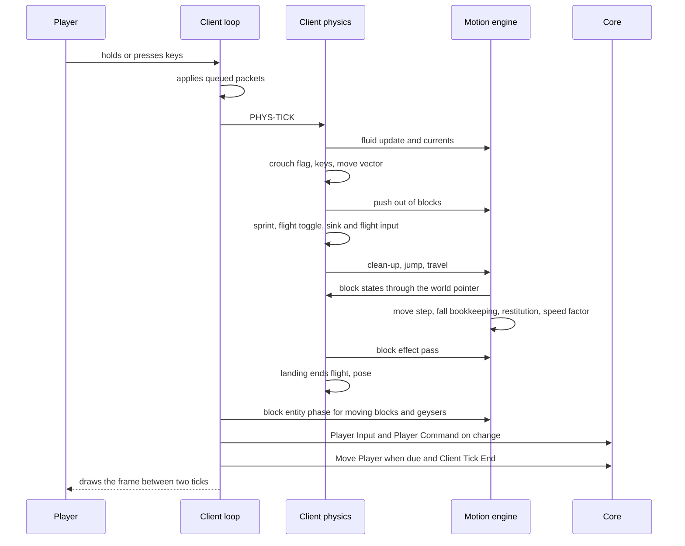
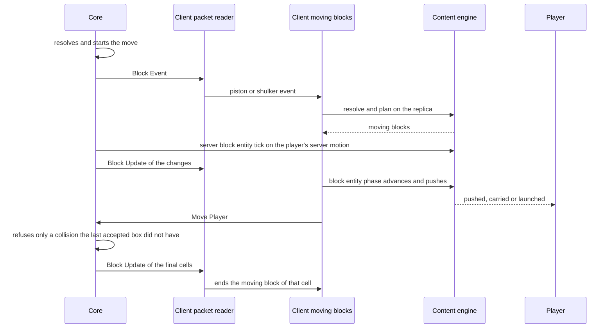
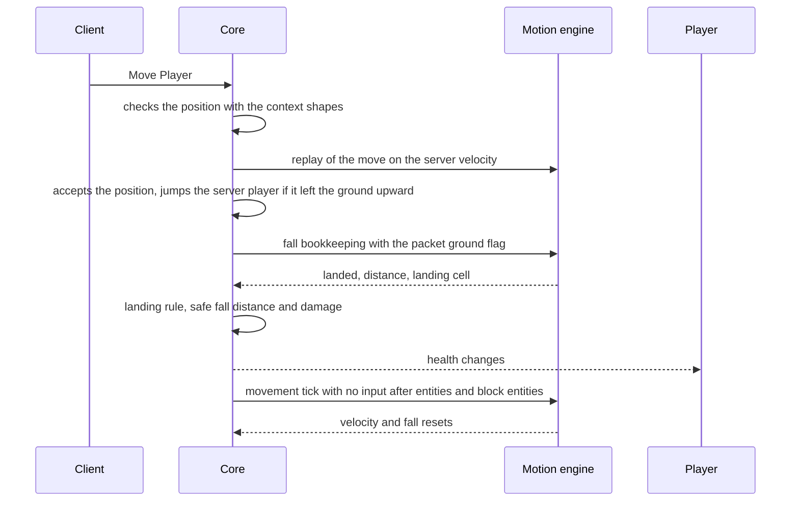
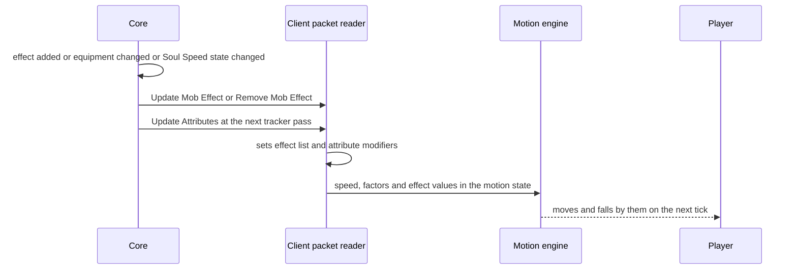
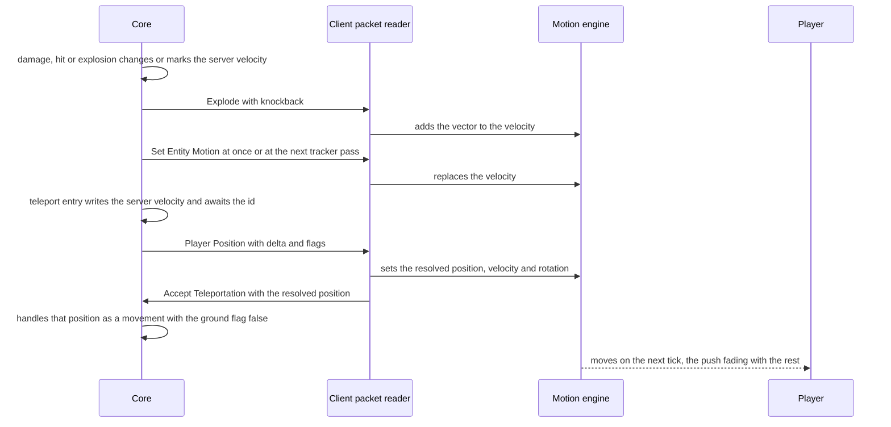
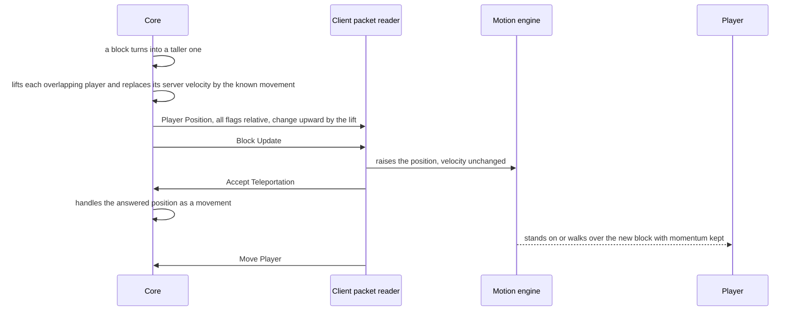

# Implementation Plan: Movement That Matches Minecraft

**Branch**: `003-vanilla-movement` | **Date**: 2026-11-26 | **Spec**: [spec.md](spec.md)

**Input**: `specs/003-vanilla-movement/spec.md`; constitution `.specify/memory/constitution.md` (project Principles I
and II with SDD amendment v6.3.0); personas `.specify/memory/personas.md`. Behaviour values come from
`docs/protocol/` and `docs/design/` only (Principle II). The movement rules are
`docs/protocol/59-player-movement-simulation.md` (cited as "59 §n") with the documents it extends; for pistons,
shulker boxes and growing blocks FR-001 adds 30 part 3, 31 part 1 §13, 51 §3.8 and 29b part 2 §9.5. This plan decides
packages, modules, data flow, tests and gates, not game values.

**Companion artifacts**: [research.md](research.md) (probes, handoff verification, documentation gaps and open
questions, decisions R1 to R25), [data-model.md](data-model.md), [contracts/](contracts/),
[quickstart.md](quickstart.md), [spikes/](spikes/).

## Operator decisions (recorded)

The authority is spec.md, Clarifications, session 2026-11-26.

| Plan question | Decision |
|---|---|
| Block movement effects | all in scope |
| Q-1 clean-room round | run once, before tasks. Done: commit `62a2c406`, new document 59 and corrections |
| Q-2 first moment on ice | match Minecraft; scenario 3 reworded |
| Q-3 effects and enchantments | Speed, Slowness, Jump Boost, Levitation, Slow Falling, Dolphin's Grace, Blindness, Soul Speed, Depth Strider, Swift Sneak in scope (scenario 16) |
| Q-4 blocks that break a fall | they spare fall damage (scenario 17) |
| Q-5 pushes | as Minecraft does them |
| A landing that hurts | removes almost all forward momentum, as in Minecraft |
| Ice back to ordinary ground | the brief speed rise, as in Minecraft |
| Q-6 which damage removes momentum | all that Minecraft does; drowning and fully blocked damage do not |
| Q-7 external pushes | pistons and shulker boxes in (scenario 18); entities, boats, minecarts and fishing hooks out |
| Q-8 effects that protect from falls | in (scenario 19) |
| Q-9 cactus damage | the damage rule covers only damage CobolCraft already deals; no cactus damage is added |
| Q-10 growing blocks | they lift the Player (scenario 20); the round for DG-11 authorised, run and reviewed |
| Q-11 drawing moving pistons | later work (spec Assumptions; CC-0063) |
| Q-12 piston limits for other entities | the exception to Principle 5.7 accepted; the limits stay in tickets (Complexity Tracking) |

No question is open.

## Summary

A Player's movement in the CobolCraft window follows the Minecraft rules in every medium, against every block that
changes movement, pistons, shulker boxes and growing blocks included, under the named effects and enchantments, with
the fall damage and the loss of momentum on damage that go with them (US1, the only story). Today the walking speed is
applied at full strength in one tick, momentum exists only as special cases, most block effects and all movement
effects are missing, the client ignores pistons, a teleport stops the Player and the server keeps no velocity for a
player.

Technical approach: one motion engine in `content`, written from document 59 and used by both sides (R15). The client
drives it every tick with the keys in the documented order. The server drives it with no input to keep its own velocity
for each player, which is what a hit sends back (R16). Block properties, player-dependent shapes and the moving blocks
of pistons and shulker boxes live in `content` (R4, R5, R21); the server computes the movement attributes of effects
and enchantments and sends them (R17); fall distance and landing rules follow the documents on both sides (R18).
Teleports, their confirmation and the lift by a growing block follow 59 §13.2 and §13.6 on both sides (R24, R25).

## Technical Context

**Language/Version**: GnuCOBOL 3.2.0, free format, `-std=default`, `-debug` (release `-O2`), with the `FPFAST`
arithmetic overlay of `tools/package.mk`. No C change planned (Principle I).

**Primary Dependencies**: none new.

**Storage**: no new saved world or player field.

**Testing**: `acc_`, `contract_`, `test_` programs, `tools/runtests.py`, gcov to 100 %, `tools/lint.py`;
cross-package tests in `tests/convergence/`.

**Target Platform**: macOS on Apple silicon.

**Project Type**: desktop game client and server in one repository of packages.

**Performance Goals**: none requested by the spec (Principle 2.7). Measured: 1.25 us for one tick of two-axis
arithmetic; 50 ns for one world query through a program pointer (research section 1).

**Constraints**: SC-001 (0.001 blocks against the worked examples of the covered rules); no pull-back or disconnect
(US1-13, SC-004); mob movement unchanged (spec Assumptions).

**Scale/Scope**: three packages and the convergence tests; `client/src/physics.cob` (19 programs, 1131 lines) replaced
in large part; the piston resolver and moving-block arithmetic move from `core` to `content`; 48 client test programs
step the changed client tick; fall start has 17 uses in `core/src` and 8 core or convergence test programs.

## Constitution Check

*Final check, 2026-11-26: after Phase 1, both clean-room rounds and the operator's answers to Q-1 to Q-12. No gate
fails. One exception, accepted by the operator, is in Complexity Tracking.*

| Principle | Status | Evidence |
|---|---|---|
| I. COBOL-first | Pass | All logic is COBOL; no new glue |
| II. Spec is the source of truth | Pass | Round `62a2c406` closed DG-1 to DG-10 and the second round closed DG-11 (research section 3). No gap is open. The jar was not read by this phase. The protocol profile (09) gets the rows for what the server newly sends in Foundational |
| 1.1, 1.2 Artifacts and sessions | Pass | This plan and its companions carry the decisions |
| 1.3 Markers and tasks gate | Pass | No open marker |
| 1.4 Deferred work | Pass | Spile tickets (`tickets/`, prefix `CC`): CC-0057 to CC-0064 |
| 2.5 Sequencing | Pass | One story; slice order below |
| 2.6 Handoff consumed | Pass | research section 2, H1 to H10 |
| 3.1 External dependencies probed | Pass with one risk | GnuCOBOL arithmetic, comparisons, narrowing, sine table and program-pointer calls probed; a real Minecraft client cannot be probed (SC-003 is manual) |
| 3.2 Gap analysis | Pass | below |
| 3.3 Boundaries and contracts | Pass | four contracts in `contracts/` |
| 3.4 Test infrastructure | Pass | below |
| 3.5 Sequence diagrams | Pass | US1, below |
| 3.6 Execution mode | Pass | standard |
| 3.7 Summary | Done at the end of the phase | delivered in the phase report, not written into this file |
| 3.8 Debt survey | Pass | below |
| 4.1, 4.3 Tests and E2E | Pass | test strategy; E2E inventory empty; no test double |
| 5.6 Error handling | Pass | None beyond the spec: the re-send of an unconfirmed teleport is a movement rule of 59 §13.2 (FR-001); the documented disconnect for a bad answer is not built |
| 5.7 Touched-file ownership | Accepted exception | `core/src/piston-push.cob` (Q-12; Complexity Tracking) |

## Project Structure

### Documentation (this feature)

```text
specs/003-vanilla-movement/
├── spec.md
├── plan.md
├── research.md
├── data-model.md
├── contracts/
│   ├── block-movement.md        content tables and shapes -> client, core
│   ├── motion-engine.md         content engine -> client, core
│   ├── moving-blocks.md         content pistons and shulker boxes -> client, core
│   └── player-motion-wire.md    core <-> client
├── quickstart.md
├── spikes/
└── checklists/requirements.md
```

### Source code (touched)

```text
contract/copy/CTBSHAPE.cpy       extended movement tables
contract/copy/CTBSCTX.cpy        new: collision context
contract/copy/CTMOTION.cpy       new: motion state
contract/copy/CTMWORLD.cpy       new: world access of the engine
contract/copy/CTMOVING.cpy       new: a moving block (piston or shulker lid)
contract/cases/, contract/fixtures/wire/
content/src/block-movement.cob   new: the movement table, shapes that depend on the player or a moving block, pose box, landing rules
content/src/block-shapes.cob     friction and climbable lists move out
content/src/motion-move.cob      new: move step, collision and step-up, edge rule, restitution, speed factor, fall bookkeeping
content/src/motion-travel.cob    new: fluids and currents, clean-up, jump, air, climbing, water, lava, ledge, flight, push-out
content/src/motion-blocks.cob    new: block effect pass, cell order, inside and step-on rules, geyser
content/src/piston-resolve.cob   new: structure resolver and move plan, moved from core
content/src/moving-blocks.cob    new: moving piston and shulker lid ticks, shapes and pushes (arithmetic moved from core)
client/src/physics.cob           PHYS-TICK in the order of 59 §2.2, PHYS-INPUT
client/src/physics-input.cob     new: move vector, sprint (leaves controls.cob), flight toggle, attributes and effects
client/src/physics-world.cob     new: the client's world access and thin entries other client code calls
client/src/moving-blocks-client.cob   new: block events of pistons and shulker boxes, the moving-block overlay, its tick
client/src/player-position.cob   new: Player Position by 59 §13.2 (leaves proto-packet.cob)
client/src/physics-fluid.cob, physics-bounce.cob   move into content
client/src/physics-glide.cob     reads the motion state; behaviour unchanged
client/src/controls.cob, smooth.cob, effects.cob, hud-packets.cob, proto-packet.cob, protocol-play.cob,
           protocol-world.cob, entities-replica.cob, session-reset.cob, shulker-box.cob, loop.cob (block entity phase)
client/copy/CLSTATE.cpy          the motion state and the moving blocks (data-model)
core/src/player-motion.cob       new: the player's server motion tick, velocity sends, pushes, moving-block effects
core/src/player-attributes.cob   new: movement attributes, Soul Speed activation, Update Attributes
core/src/player-fall.cob         new: server fall distance and landing damage
core/src/player-teleport.cob     new: one teleport entry (59 §13.2), the confirmation, the known movement
core/src/block-lift.cob          new: the lift by a growing block (29b part 2 §9.5, 59 §13.6)
core/copy/PLMOTION.cpy           new: per-player motion state (not CORESTATE.cpy, which recompiles all of core)
core/src/api.cob, movement.cob, move-check.cob, fall-rules.cob, poses.cob, combat.cob, health.cob, explode.cob,
         cmd-actions.cob, config-phase.cob, dimensions.cob, players.cob, effects.cob, farm-trample.cob, itemphys-41.cob,
         play.cob, blocks.cob, mob-18-ride.cob, end-travel.cob
core/src/piston-live.cob, piston-live-b.cob, piston-live-c.cob, piston-push.cob, redstone-30-3.cob (callers of the
         moved programs, players in the push), be-31-1.cob and furnace.cob (shulker boxes tick), the block changes
         that lift entities
core/src                         the senders of Set Entity Motion that are hits: arrows, ravager, hoglin and the others
tests/convergence/acc_f3us1_*.cob
docs/protocol/09-cobolcraft-profile.md   the packets the server newly sends a player
```

New program names are checked against the archives (`nm`) before they are fixed: names are global across linked
packages. Programs moved from `core` keep their names, and the tests that cover them move to `content`, whose gate
measures its coverage.

## Package boundary declaration (constitution 3.3)

| Story | Packages touched | Kind |
|---|---|---|
| US1 | content, client, core, tests/convergence (and `contract/`) | multi |

`proto`, `server`, `shim`, `formats` and `extract` are not changed: the codecs exist in `proto` and `server` holds no
movement code.

| Contract | Seam | Materialized as |
|---|---|---|
| [block-movement.md](contracts/block-movement.md) | content to client and core | `CTBSHAPE.cpy`, `CTBSCTX.cpy`, table and shape entries |
| [motion-engine.md](contracts/motion-engine.md) | content to client and core | `CTMOTION.cpy`, `CTMWORLD.cpy`, `MOTION-*` entries |
| [moving-blocks.md](contracts/moving-blocks.md) | content to client and core | `CTMOVING.cpy`, resolver and moving-block entries |
| [player-motion-wire.md](contracts/player-motion-wire.md) | core and client | 05a to 05c, 09, 59 §11.5 and §13, `contract/fixtures/wire/` |

All four are materialized in Foundational, before any task that consumes them.

## Design

### The client tick (59 §2.1, §2.2)

Packets are applied before the tick. The player's tick, in order: fluid update with currents and swimming flag; effect
durations; sprint timer; the crouching flag from the previous tick's shift; keys and move vector; push out of
suffocating blocks; sprint start and stop; flight toggle; sink in water; flight vertical input; timers; velocity
clean-up; input; jump; fall resets of effects; travel (with the move step and fall bookkeeping inside); block effect
pass; flight ends on landing; position clamp; pose. Then the block entity phase (moving pistons, shulker lids,
geysers), then Player Input, Player Command, Move Player and Client Tick End. Move Player follows the send rule of
05c: compared with the values last sent, a position beyond the squared distance 4.0E-8 or on the twentieth call
without one. Auto-jump (step 13) is not built (CC-0058). The keys, sprint, toggle, pose and send steps are client
code; the others are engine entries.

### The motion engine (`content`)

One implementation of the rules both sides run (59 §3.3, §4.3, §4.4, §6 to §10, §12.1 to §12.3; 30 part 8 §14.1; 51
§6.1; 53 §5 and §9). It works on one motion state record and asks the caller for block states through a program pointer
(client replica or server world). Values marked single precision in 59 are narrowed through `FLOAT-SHORT`; sine and
cosine come from the documented table (R1).

### Pistons and shulker boxes (scenario 18)

- **Shared** (`content`): the structure resolver and move plan (30 part 3 §4 to §6), the moving piston's progress,
  shape and entity rules (§7, §8), the shulker lid's progress, shape and swept slab (31 part 1 §13; 51 §3.8.8,
  §3.8.9), the collision query's extra cells for them (51 §6), and the piston and shulker mover kinds of the move step
  (59 §10.5), each piston move followed by the block effect pass (59 §9.2).
- **Client**: on a piston's Block Event it resolves the move on its replica, as Minecraft does (30 part 3 §10.1), and
  holds the moving blocks in an overlay that the physics and the resolver see and the renderer does not (CC-0063). A
  shulker box's Block Event drives a lid state of its own, not limited to the renderer's 64 boxes. The block entity
  phase advances them and pushes, carries or launches the Player. A block update from the server ends the moving block
  of that cell (30 part 3 §7.4).
- **Server**: the piston tick also applies the move to a player's server motion record: the slime velocity, the
  collision response, the speed factor and the stuck multiplier change the server velocity; the position stays the
  client's (59 §13.5). Shulker boxes are ticked (they are not today), with their neighbour updates, and push players the
  same way. The movement check sees the moving shapes.

### The server

- **Own velocity** (59 §13.5): each server tick every player runs the engine with no input, after the entity and block
  entity phases; the position is then the client's again. Replayed Move Player packets apply collision response and the
  block speed factor; a packet that leaves the ground upward jumps the server's player.
- **Sends**: every accepted full hit that is not fully blocked and not drowning marks the velocity changed, whatever its
  source; marked velocities go out before the next entity phase; a player's attack sends at once and restores; an
  explosion sends its knockback and then, when it also damaged, the velocity. Knockback is computed from the server
  velocity.
- **Fall** (59 §12): the fall distance replaces the fall start; resets come from the engine and from Slow Falling and
  Levitation; the landing table gives the damage, with Jump Boost's safe fall distance.
- **Attributes** (59 §11): the server computes movement speed, sneaking speed, water movement efficiency, movement
  efficiency and safe fall distance from effects, enchantments and sprinting, activates Soul Speed by §11.4, and sends
  Update Attributes by §11.5.
- **Movement check**: the existing checks over the new shapes and climbable cells. A position is refused for a
  collision only when the box meets a block the last accepted box did not meet (53 §10.3 rule 7, R22), so a block that
  moves into a Player pulls nobody back.

### Teleports and their confirmation (59 §13.2, 05c)

- **Server**, one entry for every teleport (join, command, portal, correction, lift): resolves the change against its
  record, its velocity becoming the known movement on each flagged axis plus the packet's delta, and the delta alone
  elsewhere; clears the movement records; advances the id; remembers the awaited position. The **known movement** is
  the displacement of the last accepted movement packet and is zeroed by a Client Tick End with none since the previous
  one. Until the newest id is answered, a Move Player changes the rotation only, a Move Vehicle is dropped and Use Item
  On does nothing; a movement packet more than 20 ticks after the last send causes an absolute re-send with zero
  velocity; an answer counts only with the newest id and only while one is awaited. The answer's position is then
  handled as a movement packet, with its checks and with the ground flags false. Minecraft's disconnect for a repeated
  or non-finite answer is not built (Principle 5.6; CC-0060).
- **Client**, in the packet phase: position, velocity and rotation by the flags, the previous-tick values moved by the
  same rules so the picture does not glide, `onGround`, fall distance and sprint untouched, a passenger ignoring the
  change; then Accept Teleportation with the resolved values, a block break in progress stopped. The values last sent
  are not changed.
- Today's fall reset at a plain teleport stays (CC-0060).

### Growing blocks (scenario 20; 29b part 2 §9.5, 59 §13.6)

One core entry takes the old and new state of a cell and lifts every player, spectators excepted, whose box overlaps
the bounds of the added shape, whether or not the Player stands on that block. The lift is computed from the server's
box and sent also when it is 0: a Player Position with change (0, lift, 0), zero velocity and rotation, and all nine
relative flags. The server's record follows 59 §13.6 (velocity replaced by the known movement, fall distance kept).
It is called by every change of the closed list that the server performs, in the documented order against the block
write: trampled farmland (a landing player's own lift coming before that landing's fall damage) and an eye of ender
filling an end portal frame. The other changes of the list do not happen in CobolCraft today (CC-0064). Mobs and other
entities are lifted as today (CC-0062).

### The client's reaction to the server (59 §13, §11)

Set Entity Motion replaces the velocity; Explode knockback adds to it; Player Position acts as above; Respawn keeps
velocity and attributes by its keep bits; a change to spectator clears the vertical velocity; a hit the Player lands
that predicts a knockback slows the Player and ends the sprint; Update Attributes replaces the listed attributes;
effects stay until Remove Mob Effect.

## Execution mode (constitution 3.6)

**Declared: standard.** Fast pass does not qualify: the story is multi-package, four shared contracts change and far
more than three production files change. Package-parallel is not warranted: it needs several stories crossing
packages, and this feature has one, whose packages depend on each other in a chain (content, then client and core).

| Phase | Content | Gate command |
|---|---|---|
| Setup | shared test helpers: a block state by key and properties, a test course, a key sequence driver, a test world for the engine, a powered piston and an opened shulker box | `make gate-tools && make gate-content && make gate-client && make gate-core` |
| Foundational | the four contracts materialized (copybooks, entries, fixtures, contract tests of both sides); moved behind them with unchanged behaviour: today's client collision, step-up, fluid and bounce programs, and the core's piston resolver, move plan, push geometry and shulker lid tick; the 09 profile rows | `make gate-contract && make gate-content && make gate-core && make gate-client` |
| US1 | every scenario, edge case and success criterion (slices below), convergence tests, updates of superseded tests | `make gate` |
| Polish | quickstart walk-through, the operator's comparison with a Minecraft client (SC-003), debt check of touched files, ticket updates | `make gate` |

Slice order inside the US1 phase (each slice starts with its tests):

1. Block tables, shapes that depend on the player, pose box.
2. Move step, air travel, jump, tick order, input and the Move Player send rule (scenarios 1 to 7; edges landing,
   wall, leaving ice).
3. Sneak, sprint, flight, push-out (scenarios 8, 11).
4. Fluids and climbing (scenarios 9, 10).
5. Block effect pass, geyser, client fall bookkeeping (scenario 15).
6. Server fall distance and landing damage (scenario 17).
7. Effects, enchantments, attributes and their fall rules on both sides (scenarios 16, 19).
8. Server velocity, damage, hits, explosions, respawn, then teleports, their confirmation and the known movement on
   both sides (scenario 13; edges push, server move, damage).
9. Pistons and shulker boxes: server acceptance and velocity first, then the client (scenario 18).
10. Growing blocks, which need slice 8 (scenario 20).
11. Cross-checks: scenarios 12 and 14, SC-001, SC-002, SC-004.

## Infrastructure setup (constitution 3.4)

Present and read on 2026-11-26: per-package `lib`, `tests`, `lint` (`tools/package.mk`), `tools/runtests.py`,
`tools/coverage.py`, generated contract tests (`contract/cases/`, `tools/gen/gen_contract.py`), the client harness
(`TEST-PLAY`, `TEST-TICKS`, `TEST-KEY-TICK`, `TEST-SET-BLOCK`, `TEST-SP-JOIN`), the core harness (`TEST-OPEN-WORLD`)
with live piston tests (`core/tests/acc_wrapb_piston_push.cob`), the convergence harness. Standard-set block shapes
build from the committed registry tables, so movement tests need no client jar
(`client/tests/test_physics_shapes.cob`); tests set the tag data they read (`TAG-PUT`).

Missing, planned in Setup: shared helpers that pick a block state by key (each test carries its own), a content-level
test world for the engine and the resolver. There is no CI in the repository (CC-0020); as in features 001 and 002 the
local gates are the verification, so it does not block. Not yet checked: whether a convergence test can open a
standard-set world without generated packs (gap T1).

## Test strategy (constitution 4.1, 4.2)

Tests come before the code they cover. Expected values are transcribed from the documents. Case names carry
"acceptance US1-<n>" with Given, When, Then. No test double (the engine's test world is a fixture of an internal seam,
not a stand-in for an external dependency). No skip: a new test never passes for lack of an input. Rules are verified
in `content` against the documents' worked examples; acceptance programs verify what the Player observes.

| Criterion | Program | Layer |
|---|---|---|
| US1-1 to US1-8 | `acc_f3us1_walk`, `_stop`, `_onto_ice`, `_ice_slide`, `_jump`, `_air_steer`, `_sprint_jump`, `_sneak` | client |
| US1-9, US1-10, US1-11 | `acc_f3us1_fluids`, `_climb`, `_fly` | client |
| US1-12, SC-002 | `acc_f3us1_world_types`: one key sequence over the same open ground under both content sets | client |
| US1-13, SC-004 | `acc_f3us1_no_pullback`: a course through every way of moving, with sprint flight over new chunks, pistons, a shulker box and a trampled farmland, against the core; counts corrections and disconnects | convergence |
| US1-14 | `acc_f3us1_start_stop_turn` | client |
| US1-15 | `acc_f3us1_blocks`: one case per row of data-model section 3 | client |
| US1-16 | `acc_f3us1_effects` (client movement per effect and enchantment); `acc_f3us1_attributes` (what the core sends); `acc_f3us1_effects_live` | client, core, convergence |
| US1-17 | `acc_f3us1_fall_damage`: every row of 59 §12.4 and reset of §12.2 that a block causes | core |
| US1-18 | `acc_f3us1_pistons` (push, slime launch, honey carry, retraction, a stuck multiplier) and `acc_f3us1_shulker` (client); `acc_f3us1_server_moving_blocks` (server velocity, shulker tick, acceptance); `acc_f3us1_pistons_live` (real pistons and boxes move a joined Player with no correction) | client, core, convergence |
| US1-19 | `acc_f3us1_effect_falls` (damage under Jump Boost, Slow Falling, Levitation); the fall cases of `acc_f3us1_effects` | core, client |
| US1-20 | `acc_f3us1_lift_server` (candidates, a box overlapping but not standing, a spectator, lift amounts 0.0625, 0.1875 and 0, the packet, the server record, trampling order, eye of ender); `acc_f3us1_lift_client` (the standing and walking examples of 59 §13.6); `acc_f3us1_lift_live` (farmland trampled under a standing and a walking Player; no correction) | core, client, convergence |
| Edges landing, wall, leave ice | `acc_f3us1_landing`, `_wall`, `_leave_ice` | client |
| Edge server move | `acc_f3us1_server_move` (flags, delta, rotation, passenger, previous position, stopped break, last-sent values); `acc_f3us1_teleport_confirm` (record, unconfirmed rules, re-send, ids, answer as movement, known movement) | client, core |
| Move Player send rule (US1-13, US1-20) | `acc_f3us1_move_send` | client |
| Edge damage takes momentum | `acc_f3us1_damage_momentum` (each damage CobolCraft deals to a Player; drowning, blocked damage and a second hit that only adds damage excepted, its extra knockback applied) | core and convergence |
| Edge push | `acc_f3us1_push` (client), `acc_f3us1_server_velocity` (core, 59 §13.5 examples) | client, core |
| SC-001 | `test_motion_examples_*` and `test_moving_examples_*` (content), `acc_f3us1_worked_examples` (client and core for the rest) | content, client, core |
| SC-003 | manual, quickstart section 4 | operator |
| Contracts | the programs named in the four contract documents | content, client, core |

Existing tests that assert superseded behaviour (for example `client/tests/acc_us3_movement.cob`,
`test_physics_ice.cob`, `test_sprint_rules.cob`, `test_motion_local.cob`, `test_explode_knockback.cob`, core fall and
knockback tests) are rewritten to the documented values in the slice that changes the behaviour; a case is removed only
when a named new case covers what it verified.

## E2E inventory (constitution 4.3)

Existing journeys: none (no `e2e_` program, no E2E environment). Proposed new or modified journeys: none. Every
criterion is observable on the client's state, in the core, or in process across both; the comparison with a Minecraft
client (SC-003) is a human judgement and stays manual.

## Empirical gap analysis (constitution 3.2)

### Package pass

| # | Package | Finding | Impact | Evidence weight |
|---|---|---|---|---|
| C1 | content | No speed or jump factor, bounce, inside effect or landing rule in the tables; friction is a key list (`block-shapes.cob` 821 to 838), climbability a class list (752 to 755) without trapdoors | HIGH | confirmed: `block-shapes.cob`, `CTBSHAPE.cpy` |
| C2 | content | No shape depends on the Player or on a moving block: scaffolding is fixed by `bottom`, powder snow and `moving_piston` have none, shulker boxes have no rule | HIGH | confirmed: `CTBSDATA.cpy` lines 125, 126, 137, 193; no shulker row |
| C3 | content | Fluid kind, level and suffocation are not offered by content; the client keeps its own state tables | MEDIUM | confirmed on the client (`ST-FLUID`, `ST-OPAQUE` in `physics-fluid.cob`); the core's equivalent suspected-not-yet-checked |
| C4 | content | What the piston resolver needs of a block (push reaction, whether it has a block entity) is read from core tables | MEDIUM | confirmed: `piston-live.cob` calls `BE-BLOCK-TYPE` and reads the core block copybook |
| K1 | client | Horizontal speed set anew each tick (0.2, 0.28, 0.5); no momentum; ice entry falls to 0.021 | CRITICAL | confirmed: `physics.cob` 173 to 235; probe `spike_move_current` |
| K2 | client | Four velocity states (fluid, ice, knockback, last move) | HIGH | confirmed: `physics.cob` 184 to 186, 290 to 330 |
| K3 | client | No input factors or square correction; no push-out | HIGH | confirmed: `physics.cob` 187 to 209 |
| K4 | client | No jump delay or jump factor | HIGH | confirmed: `physics.cob` 232 to 243 |
| K5 | client | Move order y, x, z; step-up is not 51 §6.1; flags and supporting block not those of 59 §8 | HIGH | confirmed: `physics.cob` 342 to 358, 408 to 414, 595 to 661 |
| K6 | client | No block effect pass, stuck blocks, honey slide, bubbles, powder snow, scaffolding descent, slime step, geyser, fall distance | HIGH | confirmed: `physics*.cob` read and searched |
| K7 | client | Tick order differs: sprint per frame with milliseconds, stops on key release and any collision; flight toggle per frame | MEDIUM | confirmed: `physics.cob` 55 to 69; `controls.cob` 674 to 744 |
| K8 | client | Player Position is read as absolute: velocity and flags discarded, the vertical velocity zeroed | HIGH | confirmed: `proto-packet.cob` 197 to 221 |
| K9 | client | No movement attributes or effects: only armor and max health are read; physics reads no effect | HIGH | confirmed: `hud-packets.cob` 72 to 80; `physics.cob` |
| K10 | client | The send rule differs from 05c: a fuzzy comparison drops moves below 1e-7 of the coordinate, there is no 4.0E-8 threshold and no 20-tick reminder | MEDIUM | confirmed: `protocol-play.cob` 154 to 181; probe |
| K11 | client | View bob assumes ordinary-ground drag | LOW | confirmed: `smooth.cob` 50 |
| K12 | client, core | Swimming box width differs between the two (cobolcraft set) | MEDIUM | confirmed: `physics.cob` PHYS-BOX; `movement.cob` 165 to 173 |
| K13 | client | Reads block bounce from a core program | LOW | confirmed: `physics-bounce.cob` 42 |
| K14 | client | Set Entity Motion adds the horizontal part instead of replacing; Explode splits the vector and clears on-ground | HIGH | confirmed: `physics-glide.cob` PLAYER-MOTION-SET; `physics.cob` 1121 to 1128 |
| K15 | client | Respawn clears velocity whatever the keep bits; the core sends keep 3 on travel | MEDIUM | confirmed: `protocol-world.cob` 125; `dimensions.cob` 19, 232 |
| K16 | client | The Player's own attack slows nothing | LOW | confirmed: `controls.cob` CONTROLS-SEND-ATTACK |
| K17 | client | Nothing handles a piston: its Block Event is ignored and no moving block exists | HIGH | confirmed: `proto-packet.cob` 264 to 272 handles bells and shulker boxes only; no piston code in the physics |
| K18 | client | A shulker lid has no collision or push; the lid state exists only in a 64-entry render list | MEDIUM | confirmed: `shulker-box.cob` SHULKER-EVENT, SHULKER-TICK |
| K19 | client | A teleport replaces the values last sent and stops no block break | MEDIUM | confirmed: `proto-packet.cob` 197 to 221 |
| S1 | core | Movement check uses context-free shapes | HIGH | confirmed: `movement.cob` 110 |
| S2 | core | Fall resets only for water and climbables (by box, not feet cell); no landing rule for powder snow or the dripstone tip; the straw bed is treated as a bed | HIGH | confirmed: `movement.cob` 302 to 312; `fall-rules.cob` FALL-ON-KEY, BOUNCE-OF-KEY |
| S3 | core | No gliding pose box; box and eye height duplicate the client's | MEDIUM | confirmed: `movement.cob` 153 to 174; `poses.cob` POSE-EYE |
| S4 | core | Climbable keys duplicated | LOW | confirmed: `move-check.cob` 36 to 54 |
| S5 | core | Sends a player no Update Attributes, computes no movement modifier, activates no Soul Speed | HIGH | confirmed: no call of `PB-PUT-UPDATE-ATTRIBUTES` in `core/src`; `soul_speed` appears only in trade and barter data |
| S6 | core | No player velocity: hits compute from zero; Set Entity Motion has 11 callers, none in the damage path | HIGH | confirmed: `combat.cob` COMBAT-KNOCKBACK-HIT; callers of COMBAT-MOTION-SEND |
| S7 | core | No speed check (refutes handoff H8) | LOW | confirmed: `movement.cob` MOVE-PLAYER |
| S8 | core | Block rules for honey, berry, step-on and geyser exist as programs nothing calls for a player | MEDIUM | confirmed: no `CALL` of `GC7-HONEY-INSIDE`, `GB2-BERRY-INSIDE`, `BE8-STEP-ON` |
| S9 | core | The explosion knockback equals 59 §13.5 | LOW | suspected-not-yet-checked: `explode.cob` 543, 647 |
| S10 | core | The attribute ids of 59 §11.5 are those the cobolcraft set's registry sends | MEDIUM | suspected-not-yet-checked |
| S11 | core | The server never sends a player Teleport Entity about itself, so 59 Open question 11 does not arise | LOW | suspected-not-yet-checked: callers of TELEPORT-ENTITY-BUILD |
| S12 | core | Shulker boxes are never ticked: the lid's server progress does not move | HIGH | confirmed: no `CALL` of `BE-SHULKER-TICK`; `furnace.cob` BE-TICK-ALL |
| S13 | core | The piston push skips players | HIGH | confirmed: `piston-push.cob` PST-PUSH-ENTITIES (`EN-PLAYER = 0`) |
| S14 | core | The movement check refuses any overlap, also one the last accepted box had | HIGH | confirmed: `movement.cob` 247 to 272 |
| S15 | core | The lift exists only for trampled farmland: an absolute position that zeroes momentum and restarts the fall, spectators not excluded, after the landing's fall bookkeeping | HIGH | confirmed: `farm-trample.cob` FARM-PUSH-UP; `cmd-actions.cob` CMD-MOVE-PLAYER; `movement.cob` 314 to 330 |
| S16 | core | Of the closed list (29b part 2 §9.5.3) the server performs trampling (row 1, no drying or survival change) and the eye of ender (row 4, which lifts nothing); rows 2, 3, 5, 6 and 7 never happen | MEDIUM | confirmed: no live `CALL` of `GB2-TURN-BASE` or `GC6-TRANSFER`; `worldsim-33d.cob` never stacks snow; no sculk catalyst tick; `cmds-world.cob` fails `place feature`; `end-travel.cob` |
| S17 | core | A Block Event is sent before the block updates its move causes, which the client's resolver needs | LOW | confirmed: `worldsim-33.cob` WORLDSIM-TICK (broadcast, then events) |
| S18 | core | Whether chunk data carries a moving piston's block entity to a joining Player | LOW | suspected-not-yet-checked |
| S19 | core | A Player takes no cactus, berry bush, magma or freezing damage; none is added (Q-9) | LOW | confirmed: these causes are raised only in `mob-18-3.cob` |
| S20 | core | While a teleport is unconfirmed the whole movement packet is dropped, rotation included | LOW | confirmed: `movement.cob` 237 |
| S21 | core | Nothing re-sends an unconfirmed teleport; the answer only sets a flag, its position unused, a repeated one accepted | MEDIUM | confirmed: `play.cob` 213 to 216 |
| S22 | core | Client Tick End is ignored; there is no known movement | HIGH | confirmed: `play.cob` header ("needs nothing yet") |
| S23 | core | Use Item On acts while a teleport is unconfirmed | LOW | confirmed: no reference to the confirmation in `blocks.cob` |
| P1 | proto | Codecs for the motion, position, effect, block event and attribute packets exist | LOW | confirmed: `PB-GET-LPVEC3`, `proto/src/attributes.cob`, `PB-PUT-BLOCK-EVENT` |
| V1 | server | No movement code | LOW | confirmed: search of `server/src` |
| T1 | tests/convergence | Whether a standard-set world opens there without generated packs | MEDIUM | suspected-not-yet-checked |
| T2 | client | Sprint flight doubles the top speed; unloaded cells are full cubes, so the Player could stop dead at the loaded edge | MEDIUM | suspected-not-yet-checked: `physics.cob` PHYS-CELL-SHAPE |

### Seam pass

- **block-movement**: content offers a shape by state only; both consumers assume it is complete (C2, S1). The
  contract adds the context entry and the property tables (C1, C3, K13, S3, S4).
- **motion-engine**: today there is no seam: the client holds the rules, the core holds fragments of them (S8, S2).
  The consumers differ only in input and world access, which the contract passes in.
- **moving-blocks**: the core owns the resolver and moving-block arithmetic and the client has none (K17, C4). The
  client needs the same results from the same Block Event.
- **player-motion-wire**: the core sends Player Position with velocity 0 and flags 0 and the client ignores both (K8);
  neither side handles the confirmation as documented (K19, S20 to S23);
  the core sends hit velocities computed from zero and the client adds part of them (S6, K14); the core sends keep 3
  on travel and the client discards velocity (K15); the core sends effects but no attributes (S5, K9); the core sends
  piston Block Events before the block updates, and the client drops them (S17, K17). Flight permission agrees on both
  sides.

### Rollup, coverage and routing

Deduplicated: C2 with S1, K8 with K19, K12 with S3, K13 with S4 and C1, K9 with S5, K14 with S6, K17 with C4 and S13.
The passes cover content, client, core, proto, server, tests/convergence and the four contracts. Fixed within this
plan: all of C1 to C4, K1 to K19, S1 to S6, S8, S12 to S15 and S20 to S23; S16 gets a lift at each change the server
performs, the changes it does not perform being CC-0064; T1, S9 to S11 and S18 are checked by the first task that
depends on them (T1: if the world cannot open, the test builds it through the core's test settings; S18: if the entry
is missing, the same slice sends it); T2 is asserted by the SC-004 course and a stop at the edge is fixed in this
feature. S19 needs nothing (Q-9).

## Technical debt survey (constitution 3.8)

| Tier | Debt | Removal |
|---|---|---|
| Suppression | No lint or coverage suppression found in the touched sources. Four convergence tests that move the Player skip and pass without the generated packs: `acc_bugstairfall_walk`, `acc_bugstep_village`, `acc_bugstairlight_stairs`, `acc_bugwaterstand_pool` | a test this feature edits fails loudly without its input |
| Local | `physics.cob` is oversized; its header cites the retired design section 11.4 and cites 13 §1.4 for step-up | replaced by the structure above; headers from the documents |
| Local | `EXPLODE-READ` (a packet reader) lives in the physics file | moves beside the packet readers |
| Local | Fuzzy float comparisons used as "changed" tests | R2 |
| Local | `block-shapes.cob` (1305 lines) mixes shapes with friction and climbable lists | moved to `block-movement.cob` |
| Local | Old movement constants | removed; a closing search proves no 0.2, 0.28, 0.5, 0.375 or 0.546 movement constant remains |
| Local | `physics-bounce.cob` copies a registry row at every landing to learn a block's name | table lookup |
| Local | The straw bed bounces and halves falls (S2) | table |
| Local | `BE-SHULKER-TICK` is dead code (S12) | called by the block entity tick |
| Local | The farmland lift zeroes momentum (S15) | one relative lift for every such block change |
| Local | Player Position handling inside the packet dispatcher (K8) | its own file |
| Structural | Three places build and record a teleport (`play.cob`, `movement.cob`, `cmd-actions.cob`) | one teleport entry (R24) |
| Local | A movement rule depends on the 64-entry shulker render list (K18) | lid state of its own |
| Structural | Direct-step, ice, knockback and fluid velocity paths | one velocity (R3) |
| Structural | Movement rules in the client and, in fragments, in the core | one engine (R15) |
| Structural | Block knowledge in three packages | one content table (R4) |
| Structural | Player box and eye height in client and core | one content entry (R6) |
| Structural | Fall start beside a separate fall distance field in the core | one fall distance (R18) |
| Structural | Each hit computes its velocity from nothing and sends it itself | one push entry over the server velocity (R16) |
| Structural | Piston and shulker arithmetic would be written twice (core for entities, client and server for players) | moved to content, shared (R21) |

Not taken: mob movement (`core/src/stdmobs.cob`, and the uncalled mob rule programs of CC-0039) is outside the spec;
mobs keep reading `BSH-SLIP`. Related tickets whose work this feature builds in part, updated in Polish: CC-0044 (slime
step slow-down), CC-0024 (scaffolding collision by entity, moving piston and shulker lid shapes; its unmerged branch is
not merged here), CC-0029 (honey carry and stuck multiplier, for players only).

### The open approximations of `core/src/piston-push.cob`

| Approximation | For a Player | For other entities |
|---|---|---|
| World collision of a pushed entity is an overlap test with halvings and no step up | not used: the engine's move step collides and steps (59 §10.5) | stays, CC-0062 |
| A moving block of another piston is not looked at | built: moving shapes are in the collision query | stays, CC-0062 |
| The on-ground flag keeps its value | built: set by the move step | stays, CC-0062 |
| Honey sticking (30 part 3 §8.2) | built (scenario 18) | stays, CC-0029 |
| Stuck-speed multiplier on a piston move (§8.3) | built (59 §8.1, §10.5) | stays, CC-0029 |
| A marker armour stand is not told apart | does not apply | stays, CC-0062 |

## Deferred work (constitution 1.4)

| Ticket | Item | Why deferred |
|---|---|---|
| CC-0057 | entities, boats, minecarts and fishing hooks push the Player | out of scope by the operator (spec Assumptions) |
| CC-0058 | the Auto-Jump option does nothing | not described by 13 section 1; trigger undocumented |
| CC-0059 | a spectator collides with blocks | not part of the specified movement |
| CC-0060 | weapon, command and teleport sources of movement and fall rules | outside the spec's list of movement, blocks and effects |
| CC-0061 | below 20 frames a second the Player moves slower | the spec excludes frame rate |
| CC-0062 | pistons, shulker boxes and growing blocks move other entities as in Minecraft | would change how mobs move, which the spec leaves unchanged (Complexity Tracking) |
| CC-0063 | moving piston blocks are not drawn in motion | out of scope by the operator (Q-11, spec Assumptions) |
| CC-0064 | farmland drying, paths, mud, snow layers and sculk spread do not turn into taller blocks | block growth behaviour the server lacks; building it changes behaviour the spec leaves unchanged |

## Risks

| Risk | Handling |
|---|---|
| The client moves its pistons later than the server by the connection's delay, so the two see different moving blocks for some ticks | acceptance rule R22; live piston tests and the SC-004 course, also over a network connection |
| The client resolves a piston on a replica that differs from the server's world | the server's block updates end the moving block; test with a refused and a differing move |
| Moving the resolver and arithmetic from `core` breaks live pistons | Foundational moves them unchanged, with the existing piston tests green and their coverage moved to `content` |
| The new acceptance rule lets a Player already inside a block keep moving within it, as Minecraft does | tests for entering a block (still refused) and moving inside one |
| A client tick can fall between a lift and its block update when they travel apart (59 Open question 12) | the live lift test and the SC-004 course; both arrive together for lifts inside the level tick |
| What follows a lift of a riding Player is not traced (59 Open question 13); the walking example's server jump is inferred (14) | the documented rules are followed as written; riding is unchanged by the spec |
| The server newly acts on the answer to a teleport and re-sends unanswered ones, which could disturb a client that behaved well enough until now | the CobolCraft client answers each id once (tested); a Minecraft client is tried in SC-003 |
| A client that sends no Client Tick End leaves the known movement stale | the CobolCraft client sends it each tick (`loop.cob`); Minecraft does too (05c) |
| The server velocity's effects follow from read tick order and were never observed (59 Open question 6); packet timing differs between single-player and a network | core tests on the §13.5 examples; SC-003 |
| Seven minor fixes to the round's documents were not reviewed again; its worked examples are computed, not observed | a test that contradicts the rule text stops its slice and goes back to a round |
| The work is far larger than first planned, in one implementation phase | Foundational moves code behind the seams without changing behaviour; slices end in tests |
| Many existing tests encode the old behaviour; the number that fail is unknown | each slice runs and rewrites the tests it affects |
| Sprint flight reaches unloaded chunks (T2) | SC-004 course |
| Client and server read shift, boots or fall distance a moment apart | SC-004 course drives scaffolding and powder snow with the key changing |
| `suppresses_bounce`, `causes_suffocation` and other tags come from the data packs; tests without them set them | helpers in Setup; a missing tag fails the test loudly |
| An `FPFAST=0` build takes 7 s to build the sine table (probe) | the table is built once, on first use; gates use `FPFAST=1` |
| A coverage build needs several GB, and free space on this machine has run low before | check free space before `make gate` |
| SC-003 depends on a person with a Minecraft client joining the same world | quickstart section 4 |

## Spec observations (not changes to the spec)

- Scenario 20 now lifts any Player whose body is where the block grows, as the documented rule does (29b part 2
  §9.5.1; 59 §13.6, walking case B); the operator chose this wording after the plan was final.
- Scenario 20's example, farmland turning back into dirt, happens in CobolCraft only by trampling (CC-0064): a standing
  Player is lifted when something else tramples the block under them, or after their own landing. The other change the
  server performs that lifts is an eye of ender filling an end portal frame. The operator decided farmland drying stays
  out of this feature (spec Clarifications and Assumptions).
- SC-001's covered examples leave out those of entity pushes, the fishing hook and wind charges (research section 3).
- US1-1 states speeds per second; below 20 frames a second today's client runs fewer ticks (CC-0061), which the spec's
  frame-rate assumption sets aside.
- Scenario 14 is the closest thing to a completeness criterion for the replaced behaviour; the debt survey's closing
  search covers the stragglers.
- Scenario 12 holds with each content set's own body size (R11).

## Sequence diagrams (constitution 3.5)

### US1: one client tick (scenarios 1 to 12, 14, 15)



### US1: pistons and shulker boxes (scenarios 13, 18)



### US1: the server's movement tick and fall damage (scenarios 13, 17, 19)



### US1: effects and enchantments (scenarios 16, 19)



### US1: damage, pushes and server moves (scenario 13; edges push, server move, damage)



### US1: a growing block lifts the Player (scenario 20)



## Complexity Tracking

| Violation | Why Needed | Simpler Alternative Rejected Because |
|---|---|---|
| Principle 5.7: this feature edits `core/src/piston-push.cob` and leaves its limits for entities other than players (CC-0062, CC-0029). **Accepted by the operator, 2026-11-26** (Q-12, spec Clarifications) | Fixing them changes how mobs move, which the spec leaves unchanged. Items, carts and boats share the same code | Not editing the file would keep the push geometry written twice; fixing only non-mob entities would split one server path for behaviour the spec does not ask for |
